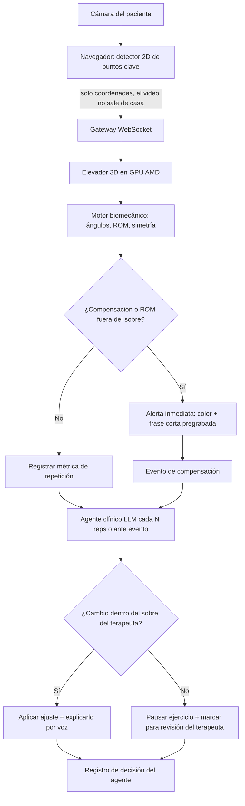
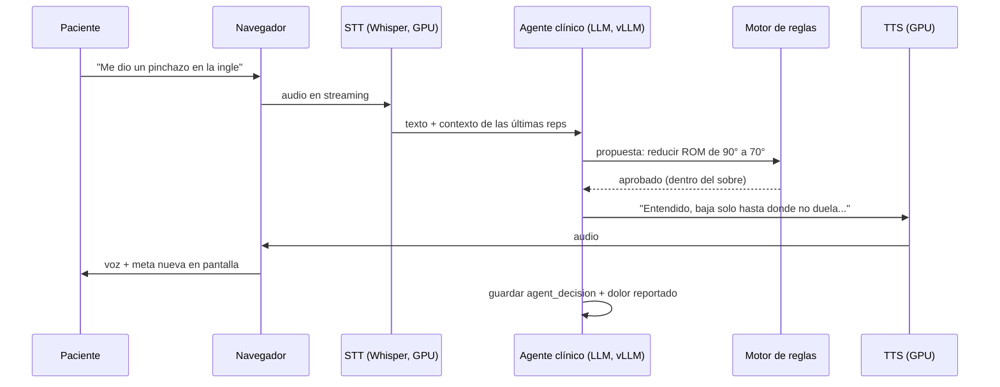
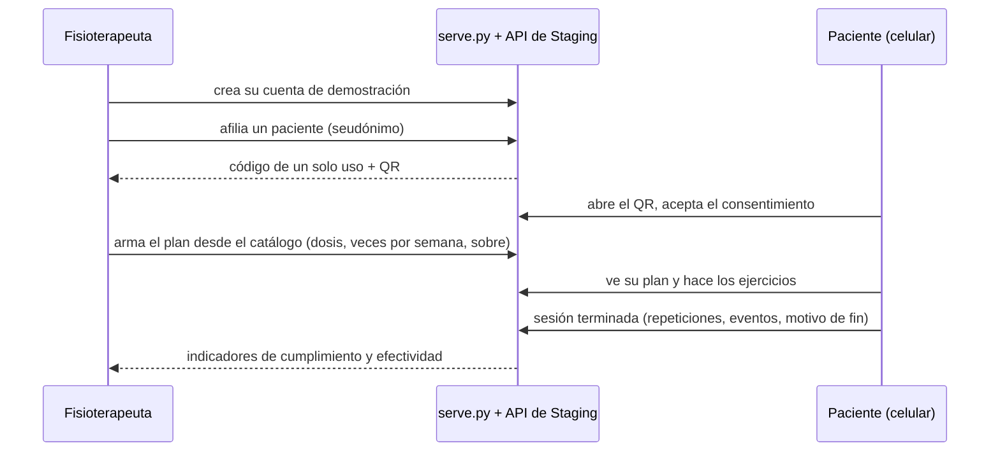

# 01 · Lógica del sistema

> Proyecto: **AXONFAS** · Entorno actual: **Staging** · Actualizado: 2026-10-17
> Estado de implementación: hay código en Staging. Existen el prototipo de validación del navegador (secciones al
> final), la API de Staging con cuentas, nota SOAP y export FHIR, y los agentes con sus reglas deterministas, probados
> sin GPU. El paciente ya puede avisar de una molestia sin GPU (ADR-021) y ver el descanso recomendado (ADR-022).
> Falta lo que corre en la GPU (TD-04) y conectar el turno de voz al prototipo (TD-61).

## Idea central

El sistema trabaja con **dos bucles separados**. Esta es la decisión técnica más importante del proyecto, porque de ella depende que sea seguro para un paciente ([ADR-004](04-decisions-adr.md)).

| Bucle | Qué hace | Quién decide | Latencia objetivo |
|---|---|---|---|
| **Rápido (seguridad)** | Detecta una compensación o un ángulo fuera de rango y avisa en el momento | Motor de reglas biomecánicas (determinista) | < 250 ms |
| **Lento (razonamiento)** | Ajusta series, rango y pausas, y responde lo que dice el paciente | Agente clínico (LLM) | 1–2 s |

El LLM **nunca** está en el camino de una alerta de seguridad. Solo puede mover parámetros dentro del **sobre de seguridad** (`safety_envelope`) que el fisioterapeuta definió en el plan de cuidado ([ADR-005](04-decisions-adr.md)).

## Flujo de una repetición

## Detección de cadena de compensación (diferenciador)

Las apps actuales miden **una** articulación contra un umbral. AXONFAS mide **la relación entre segmentos**: cuando el ángulo objetivo mejora pero otro segmento empieza a desviarse, eso es compensación.

Regla base para el demo (sentarse y pararse / sentadilla, [ADR-009](04-decisions-adr.md)):

1. `rodilla_flexión` alcanza el rango pedido **y**
2. `tronco_flexión` sube más de X° respecto a la línea base del paciente **o**
3. `rodilla_valgo` supera Y° **o**
4. `asimetría_carga` izquierda/derecha supera Z%

→ se genera un `compensation_event` con tipo, severidad (1–3) y la repetición donde ocurrió.

Los umbrales X, Y, Z **no se inventan**: se toman de la línea base de calibración del propio paciente (primeras 3 repeticiones) y los ajusta el fisioterapeuta.

## Turno de voz

## Reglas del agente clínico

- Si el paciente reporta **dolor agudo, mareo o pérdida de fuerza súbita** → detener la sesión y mostrar el mensaje de contactar al profesional. No se intenta "resolverlo".
- El agente propone cambios en formato estructurado: JSON `{param, old, new, reason}` (parámetro, valor anterior, valor nuevo y motivo), el mismo que guarda `agent_decision.proposal`. El motor de reglas los valida contra el sobre. Esquema completo en [06 · API y MCP](06-api-mcp.md).
- Todo cambio queda en `agent_decision` con su motivo, para auditoría del terapeuta.

### Cómo está implementado (ADR-016, `src/agents/`)

| Paso | Quién | Regla |
|---|---|---|
| 1. Alarma | `safety.red_flag` (determinista) | Dolor agudo, fuerte, intenso, punzante o "me duele mucho"; mareo; pérdida de fuerza (también "pérdida de fuerza súbita"), sentirse débil o debilidad; pierna dormida, adormecida, entumecida u hormigueo; "se me dobló la rodilla"; "no puedo mover la pierna"; desmayo, dolor de pecho, falta de aire, "algo se rompió". Si aparece, la sesión termina con `pain_stop` y **no se consulta al LLM** (I-7). Ante la duda, detener: un falso positivo solo corta la sesión |
| 2. Propuesta | `clinical.propose` (LLM, JSON) | Un solo ajuste de `rom_target`, `reps` o `rest_seconds`, o ninguno. Respuesta rota o sin LLM = sin cambio (`rejected`). **Con molestia** (ADR-021), si el LLM no propone una baja válida, la propone el motor de reglas (`safety.reduce_demand`) y la decisión lleva `source: "rules"`, con lo que dijo el LLM en `llm_outcome` y `llm_proposal`; si no hay nada que bajar, `paused: true`. Las demás decisiones llevan `source: "llm"` |
| 3. Validación | `safety.validate` (determinista) | `old` igual al valor actual, motivo no vacío, valor numérico. Cada parámetro necesita su límite del fisioterapeuta: `rom_target` exige `rom_min` y `rom_max` (con `rom_min < rom_max`) y `reps` exige `max_reps`; si falta → `rejected` (I-3). `rest_seconds` solo tiene los límites fijos 10–180. Dentro del sobre → `applied`; fuera → `escalated_to_therapist` y se pausa el ejercicio. **Regla de dirección (ADR-021):** si el paciente acaba de decir una molestia (`DISCOMFORT`: molestia, duele, dolor, pinchazo, punzada, tirón, ardor, calambre, cansado, fatiga, agotado, "me cuesta", "no aguanto", rígido, incómodo), solo se acepta bajar la exigencia; subirla → `escalated_to_therapist` con `within_envelope = true` (I-16). El sobre de Staging se traduce con `safety.agent_envelope` |
| 4. Frase | `coach.reply` (LLM opcional) | Dice lo que decidió el motor. Si el LLM agrega un número que no está en la decisión (en cifras o en letras, como "veinte"), pasa de 30 palabras o devuelve JSON, se usa la plantilla |
| 5. Nota SOAP | `soap.draft` (LLM opcional) | S y O salen de una plantilla con los datos de la sesión; el LLM solo redacta A y P, y se descartan si traen cifras (en cifras o en letras) que no están en los datos; la fecha no cuenta como dato citable (I-6). Siempre `status: draft`, `reviewed_by: null` (I-8). En Staging la genera y la firma el fisioterapeuta desde el panel (sección "Cuentas y seguimiento") |
| 6. Molestia | `safety.classify_symptom` y `safety.symptom_record` (deterministas) | Clasifica lo que dijo el paciente: `red_flag` (gana siempre) o `discomfort` con categoría `pain`, `cramp`, `fatigue`, `stiffness` u `other`. El turno devuelve `symptom` = `{kind, category, text (≤ 200), action, adjustment}`, con `action` `session_stopped`, `demand_lowered` o `paused`. Staging lo guardará con `source = 'voice_turn'` cuando se conecte TD-61 (TD-88) |

Sin propuesta (`action: none`) no se guarda `agent_decision`. La alarma no es una decisión del agente: es un fin de sesión.

## Fin de sesión

1. Consolidar métricas por repetición → resumen de sesión.
2. El LLM redacta un borrador de **nota SOAP** con datos reales de la sesión (no inventa cifras: solo usa campos de la BD).
3. Exportar como `Observation` FHIR R4 + PDF ([ADR-008](04-decisions-adr.md)).
4. Sumar el día al periodo de monitoreo (`monitoring_period.days_with_data`) para el modelo de negocio RTM.

## Invariantes

Resumen de lo que el código nunca puede violar. Cada uno sale de las secciones anteriores, de un ADR o de las reglas de integridad de [03 · Base de datos](03-database.md).

| # | Invariante | Origen |
|---|---|---|
| I-1 | El LLM nunca decide ni retrasa una alerta de seguridad: la alerta la emite solo el motor de reglas | ADR-004 |
| I-2 | Ningún ajuste del agente se aplica fuera del `safety_envelope`: `outcome = 'applied'` exige `within_envelope = true` | ADR-005, 03 |
| I-3 | Sin `consent_given` no se crea una sesión, y sin sobre configurado no se inicia | ADR-005, 03 |
| I-4 | El video no sale del navegador: al servidor solo llegan coordenadas 2D (y el audio de voz) | ADR-003 |
| I-5 | Los umbrales de compensación salen de la línea base del paciente (3 reps) y los ajusta el terapeuta | Esta pestaña |
| I-6 | La nota SOAP solo usa campos de la BD; nunca cifras inventadas | Esta pestaña |
| I-7 | Dolor agudo, mareo o pérdida de fuerza súbita detienen la sesión; el agente no intenta resolverlo | Esta pestaña |
| I-8 | Un reporte sin `reviewed_by` es borrador y no se exporta fuera de Staging | ADR-008, 03 |
| I-9 | No se registra una sesión de un ejercicio que no esté en el plan activo del paciente; en los monitoreados, el sobre lo fija el fisioterapeuta y el paciente no lo puede cambiar | ADR-005, ADR-012 |
| I-10 | Un fisioterapeuta solo ve y modifica a sus propios pacientes; a cualquier otro la API le responde "no existe" | ADR-012 |
| I-11 | El canal en vivo lleva ángulos o la medida del ejercicio, el avance, la fase, las repeticiones, los eventos y hasta 15 puntos 2D; nunca video ni imágenes | ADR-003, ADR-013, ADR-014 |
| I-12 | El seguimiento de la galería solo cuenta: no emite alertas de compensación. Las alertas son solo del motor de reglas de sentarse y pararse. Pasar el límite de la meta del plan solo marca la repetición | ADR-004, ADR-009, ADR-014, ADR-025 |
| I-13 | Una sugerencia nunca cambia el plan por sí sola: el fisioterapeuta la revisa y guarda. Las del usuario nunca tocan la dosis, y la IA solo resume las que ya calcularon las reglas | ADR-005, ADR-017 |
| I-14 | El rol de Administrador sale solo de `AXONFAS_ADMIN_EMAILS` y su vista no muestra datos clínicos; todo inicio de sesión con Google se verifica en el servidor (firma, emisor, destinatario, vigencia y correo verificado) | ADR-019 |
| I-15 | La IA solo sale de infraestructura de AMD (Token Factory o el vLLM propio en una MI300X); sin proveedor configurado no hay IA y la interfaz lo dice | ADR-018 |
| I-16 | Ante una molestia, el sistema solo baja la exigencia: si el agente no propone una baja válida, la aplica el motor de reglas dentro del sobre; sin límites, pausa. Toda molestia se registra y se avisa al fisioterapeuta | ADR-005, ADR-021 |
| I-17 | Sin descargo aceptado y triaje vigente no hay rutinas de autogestión; una bandera roja las bloquea y recomienda urgencias o una consulta. El triaje es de reglas fijas: ningún LLM lo decide ni lo resume, y las respuestas no salen del navegador | ADR-023 |
| I-18 | El dolor al terminar (EVA) lo marca solo el paciente, una vez por sesión. No detiene ni cambia el plan y ningún LLM decide con él; ante dolor agudo, mareo o pérdida de fuerza vale I-7 | ADR-025 |
| I-19 | La administración de una organización (Nivel 3) solo ve su plan, sus licencias y cuántos pacientes atiende cada profesional: nunca sesiones, notas, molestias ni alias de pacientes. La dirección FHIR de su historia clínica es https y nunca lleva credenciales | ADR-026 |
| I-20 | Una sesión sin cámara la marca el servidor (`no_camera`, por `source = 'guided'`) y no lleva métricas cinemáticas ni eventos. El panel, la nota SOAP y FHIR lo dicen siempre con el mismo texto | ADR-029 |
| I-21 | El invitado solo mira: lo permanente o clínico responde `auth_required` y pide una cuenta. La demo pública guarda solo números anónimos que nadie más que el Administrador lee | ADR-028 |

## Reglas de seguridad de la pista Health and Wellbeing

AXONFAS compite en la pista 2 del AMD Developer Hackathon: ACT III (brief revisado el 2026-10-06). El brief exige que el
producto no presente diagnóstico ni tratamiento autónomo como consejo médico, que haga visible la incertidumbre y que
sepa cuándo una persona debe revisar o tomar el caso. Así responde el diseño a cada punto que pide explicar:

| Lo que pide el brief | Cómo lo resuelve AXONFAS | Origen |
|---|---|---|
| Sin diagnóstico ni tratamiento autónomo | El plan lo prescribe el fisioterapeuta; el agente solo ajusta dentro de su sobre; el reporte es borrador hasta que lo firma | ADR-005, ADR-008 |
| Respuestas incorrectas o sin soporte | El agente solo propone en JSON y el motor de reglas valida; la nota SOAP solo usa campos de la BD | I-2, I-6 |
| Información sensible | El video no sale de casa; pacientes con seudónimo; en Staging solo datos sintéticos | ADR-003, ADR-010 |
| Resultados inciertos | **Hecho en el prototipo; falta validarlo con fisioterapeutas (TD-06).** Se muestra la confianza de la pose; los frames poco confiables no se evalúan, se avisa y la repetición queda marcada; la preparación de la cámara no alerta lo que no se ve bien desde la vista real | TD-25, ADR-015 |
| Decisiones de alto riesgo | Alertas deterministas fuera del LLM; dolor agudo, mareo o pérdida de fuerza detienen la sesión; un cambio fuera del sobre pausa el ejercicio; ante una molestia solo se baja la exigencia, con reglas y dentro del sobre, y se avisa al fisioterapeuta; sin plan del fisioterapeuta, un triaje de banderas rojas bloquea las rutinas y deriva a urgencias o a una consulta | I-1, I-7, I-16, I-17 |
| Revisión humana | `outcome = 'escalated_to_therapist'` marca el caso para el terapeuta. Cada molestia le llega en vivo al panel, cuenta en "Molestias 30 días" y genera una sugerencia que él revisa (I-13). En Staging, el fisioterapeuta revisa, completa y firma la nota SOAP en el panel; sin firma es borrador y la Observation sale `preliminary` | ADR-005, ADR-021, TD-09 |

## Prototipo de validación (TD-28)

Versión mínima del bucle rápido que corre solo en el navegador, para validar con fisioterapeutas el ejercicio, las dos
compensaciones y el sobre (TD-06). Código en `src/frontend/validation-prototype/`; tests en `tests/validation-prototype/`.
No usa GPU, LLM ni voz de entrada, y no guarda nada.

| Paso | Regla implementada | Valor de partida (a validar) |
|---|---|---|
| Ángulos | Flexión de rodilla (3D), flexión de tronco contra la vertical y valgo en el plano frontal de la pelvis (ADR-024), con los puntos "world" de MediaPipe en lugar del lifter de ADR-006 | Giro corregido hasta ±45°, suavizado 0,15 por frame |
| Repetición | Empieza cuando la rodilla baja del umbral de sentado y termina al volver a sentarse habiendo llegado a estar de pie; si no llegó a pararse, no cuenta y se dice por qué. **De pie de verdad** (TD-55): las dos rodillas estiradas, la cadera a la altura de estar de pie sobre los tobillos y los dos pies en el suelo. Estirar una pierna sentado baja el promedio de las rodillas casi igual, pero no sube la cadera y deja un tobillo en el aire: no cuenta ("ponte de pie con los dos pies apoyados") | Sentado ≥ 65°; de pie: promedio ≤ 25° y cada rodilla ≤ 35°, cadera ≥ 85 % del largo de la pierna, pies a menos del 15 % de diferencia de altura |
| Línea base | Media de los picos de las 3 primeras repeticiones válidas (I-5). Una repetición con más del 20 % de frames dudosos no sirve para calibrar y se repite | 3 repeticiones |
| Umbrales | Línea base + margen del terapeuta para tronco (X) y valgo (Y); rango pedido = línea base − 10° si el terapeuta no lo fija | X = 15°, Y = 10° |
| Compensación | Solo se evalúa si la repetición alcanzó el rango pedido. Un evento por tipo y lado en cada repetición: la alerta sale en el primer frame que cruza el umbral y el evento guarda el pico | — |
| Severidad | Según cuánto supera el umbral el pico de la repetición | 1 si < 5°, 2 si < 10°, 3 si más |
| Incertidumbre | Si la menor visibilidad de los puntos clave baja del mínimo, el frame no se evalúa, se avisa y la repetición queda marcada (adelanto de TD-25) | 0.6 |
| Fin | `completed` al llegar a las repeticiones pedidas, `pain_stop` con el botón de dolor (I-7), `user_quit` al terminar a mano | 10 repeticiones |

**Valgo en el marco de la pelvis (ADR-024, TD-96).** Una cámara sola mide mal lo que pasa en el plano frontal mientras el
movimiento principal es sagital: el error de paralaje del estudio de tele-rehabilitación. Antes de medir, el motor lleva
el esqueleto a un marco propio de la pelvis (`normalizeSkeleton` en `engine.js`):

1. **Origen** en el punto medio de las caderas (puntos 23 y 24 de MediaPipe).
2. **Giro anulado:** se rota alrededor de la vertical para que la línea entre las caderas quede sobre el eje x. El giro
   sale de la profundidad (z), que MediaPipe estima peor, así que la sesión lo suaviza (0,15 por frame, unos 0,2 s a
   30 fps) y lo limita a ±45°; de espaldas se toma el mismo plano frontal. Más allá de 62° la preparación de la cámara ya
   apaga el valgo (ADR-015).
3. **Escala** = ancho de cadera: las caderas quedan en x = ±0,5, así que la estatura y la distancia a la cámara no
   cambian nada.

En ese marco, el valgo es el desplazamiento de la rodilla hacia la línea media respecto de la línea cadera-tobillo, en
grados contra la tibia proyectada en el plano frontal (sin la profundidad). Positivo = valgo; negativo = varo. Al muslo
que apunta a la cámara estando sentado no le afecta. Con la cámara a 30°, el proxy anterior perdía el coseno del giro
(9,0° en vez de 10,4°); ahora da lo mismo que de frente, y el demo sintético girado 30° da las mismas alertas. La validez
contra un sistema con marcadores (Vicon o Qualisys) sigue pendiente (TD-16, TD-57).

**Voz situacional (TD-97).** La pantalla muestra una orden corta, legible a 2–3 m ("Rodilla izquierda hacia afuera"), y
la voz dice qué pasa, de qué lado y qué hacer ("Tu rodilla izquierda se está yendo hacia adentro: llévala hacia
afuera"), para que el paciente se corrija sin mirar la pantalla.

## Triaje del Nivel 1 (ADR-023)

AXONFAS se organiza en tres niveles, según el estudio de tele-rehabilitación del 2026-10-17: **Nivel 1**, autogestión
preventiva con triaje; **Nivel 2**, tele-rehabilitación guiada por el plan del fisioterapeuta (lo que ya hace ADR-012);
**Nivel 3**, empresa B2B (TD-102). El Nivel 1 cubre las rutinas que alguien hace sin un plan: el seguimiento libre (la
página entera) y la cámara del Prototipo sin `?plan=` (se pide al encenderla, `AxonTriage.ensure()`). La galería y el demo
sintético se exploran sin triaje: no son ejercicio (ADR-028).

| Paso | Regla (`triage.js`) | Valor de partida (TD-98) |
|---|---|---|
| Descargo | Cinco puntos (no diagnostica ni trata, no es un dispositivo médico, no reemplaza a un profesional, ante un síntoma agudo detenerse, la cámara estima) y una casilla obligatoria | — |
| Banderas rojas | Ocho preguntas de sí o no, todas obligatorias: incontinencia o retención reciente, anestesia en silla de montar, cáncer, pérdida de peso sin causa, trauma reciente, dolor nocturno que no cede (las seis del estudio), fiebre con el dolor y debilidad u hormigueo que avanza (guías habituales) | — |
| Bloqueo | Una sola bandera roja bloquea las rutinas en ese equipo y recomienda urgencias (SAMU 106 en Perú o el número de emergencias del país) o una consulta; ofrece entrar como paciente. Antes se pide confirmar lo marcado, para que un toque equivocado no bloquee | 24 h |
| Banderas amarillas | Tres preguntas opcionales (miedo a moverse, catastrofismo, evitación). Nunca bloquean: solo hacen más cuidadoso el tono del mensaje | — |
| Vigencia | Sin banderas rojas, el triaje vale una semana; cambiar las preguntas (`VERSION`) obliga a responder de nuevo | 7 días |
| Exentos | Modo paciente (`?plan=` con cuenta de paciente: su fisioterapeuta ya lo evaluó) y cuentas de fisioterapeuta o Administrador | — |

Son reglas fijas y sin IA (I-17). Las respuestas no salen del navegador ni se guardan; solo queda el resultado, su
vencimiento y el tono (03 · `axonfas.triage`). Es una puerta del lado del cliente: sirve para orientar y proteger a quien
la usa, no como control de acceso. Esa parte vendrá con las cuentas reales (TD-41).

## Gemelo digital del Prototipo (TD-101)

Con la cámara, el video y el esqueleto se ven en espejo (clase `.mirror` de `pose-camera.js`): la persona se ve como
frente a un espejo. `twin.js` dibuja el esqueleto con los colores de los tokens y, mientras dura una alerta del motor,
pinta en `--alert` los segmentos que compensan y agrega una guía de corrección en `--safe`:

| Alerta | Línea objetivo (punteada) | Flecha |
|---|---|---|
| Valgo de rodilla (izquierda o derecha) | De la cadera al tobillo de ese lado | De la rodilla al punto de esa línea a su misma altura |
| Flexión de tronco | El mismo tronco, vertical desde el centro de la cadera | Del centro de los hombros a ese punto |

Solo dibuja: la alerta sale del motor de reglas (I-1). No escribe texto en el canvas, porque el espejo lo invertiría.

## Invitado, muro de autenticación y demo pública (ADR-028)

| Pieza | Regla | Valor de partida (TD-113) |
|---|---|---|
| Invitado | `POST /api/auth/guest` da un token `guest` sin registro ni datos personales. Con él, `doctor.html` lee un consultorio de muestra compartido (un paciente con seudónimo, su plan y tres sesiones sintéticas: monitoreada con dos alertas, con cámara y sin cámara) | — |
| Muro diferido | Toda ruta que guarda o cambia algo, o que es de otro rol, responde 401 con `code: 'auth_required'`; `api-client.js` emite `axon:auth-required` y `auth-wall.js` abre el diálogo "Crea tu cuenta para seguir" (se cierra con "Seguir explorando"). Sin cuenta, el seguimiento libre es una vista previa de una serie | 1 serie |
| Demo pública | El demo del Prototipo queda abierto. Al terminar, si la casilla "Compartir resultados anónimos" sigue marcada, manda solo números (`demo-telemetry.js` → `POST /api/demo/runs`): fuente, repeticiones, calibración, alertas por tipo, repeticiones mal vistas, duración y motivo de fin. Solo el Administrador los ve | 500 por hora |
| Triaje | Se pide donde se hace ejercicio: el seguimiento libre y la cámara del Prototipo. La galería y el demo sintético no lo piden | — |

Con una cuenta de verdad, el modo invitado termina y `login.html?next=` vuelve a la página que pidió la cuenta (solo un nombre
de página local).

## Tutorial y rutina sin cámara (ADR-029)

| Paso | Regla (`practice.js`, `seguimiento.js`) |
|---|---|
| Tutorial (shadowing) | La primera vez que se usa la cámara con un ejercicio en ese equipo, va antes "Mira y sigue": la guía animada en grande para hacer el movimiento junto con ella. No se cuenta nada ni se usa la cámara. "Ver y practicar" lo repite cuando se quiera |
| Sin cámara | Si el permiso se niega, no hay cámara o falla el modelo, la página ofrece seguir sin cámara en vez de bloquearse; también se elige con "Hacer sin cámara". La guía queda en grande marcando el ritmo, un botón grande «Hecha» suma cada repetición (con deshacer) y el descanso entre series se propone igual |
| Registro | En modo paciente se guarda con `mode: 'guided'`, `source: 'guided'` y el motivo (`declined`, `denied` o `unavailable`); el servidor pone `no_camera = 1` (I-20). Las sesiones guiadas anteriores quedan con `guided_view` |
| Reporte | El panel muestra "Sin cámara" en la lista y, en la nota, el aviso destacado: "Sesión completada sin cámara. No se registraron métricas cinemáticas ni detección de fallos posturales." La O de la nota SOAP dice lo mismo en lugar de "Compensaciones: ninguna", y la Observation FHIR lleva `camera-used: false` |

## Nivel 3: organizaciones y licencias (ADR-026)

Una organización (clínica u hospital) contrata un plan con un cupo de licencias de profesional. El Administrador
maestro la crea con un correo de administración; esa cuenta de Google entra a `empresa.html`.

| Regla (`organizations.py`) | Valor de partida (TD-105) |
|---|---|
| Planes: "Clínica pequeña" y "Red hospitalaria", sin precio (el modelo de negocio se valida, 04 · Anexo) | 5 y 50 licencias; cupo de 30 y 40 pacientes por licencia |
| Cada profesional invitado por correo ocupa una licencia activa; no se invita si no quedan libres | — |
| Un correo tiene a lo sumo una licencia activa en todo el sistema; una licencia liberada se puede volver a invitar | — |
| Al entrar con Google con ese correo y ser fisioterapeuta, la licencia se vincula a su cuenta | — |
| Liberar una licencia no toca al fisioterapeuta ni a sus pacientes: la organización deja de contarlo | — |
| La dirección FHIR de la historia clínica: https, sin usuario, clave, consulta ni fragmento; nunca credenciales. En Staging solo se guarda: no se envía nada (TD-20) | — |
| Con licencia activa, la nota SOAP como documento FHIR lleva a la organización como custodio (TD-103) | — |

El panel de empresa solo muestra conteos (I-19). La administración de una organización tiene prioridad sobre otro rol
de la misma cuenta de Google, salvo el Administrador maestro: quien dirige la clínica y además atiende usa otra cuenta.

## Galería de ejercicios (ADR-011)

24 ejercicios en cuatro temáticas: rodilla y cadera, columna lumbar y cervical, hombro, y equilibrio y caídas. Cada uno
cita su fuente pública y la dosis que esa fuente indica; el fisioterapeuta la ajusta al armar el plan.

| Monitoreo | Ejercicios | Qué hace el sistema |
|---|---|---|
| Automático | Sentarse y pararse (la prueba de 30 s de CDC STEADI) | Cámara, motor de reglas, línea base y alertas (secciones anteriores) |
| Seguimiento con cámara | Los 24, incluido sentarse y pararse (ADR-014) | Esqueleto, medida del ejercicio, conteo de repeticiones o sostenes y mapa muscular según el avance. Sin detección de compensaciones (sección siguiente) |
| Guiado sin cámara | Los otros 23, como alternativa | Muestra pasos, músculos y huesos; cuenta series y el tiempo de sostén; el paciente marca cada serie |

## Preparar la cámara (ADR-015)

Antes de cada sesión con cámara, la persona elige dónde va la cámara y el sistema revisa en vivo que se vea bien.

| Vista | Hacia adelante (sagital) | Hacia el costado (frontal) | Giros (transversal) | Subir y bajar (vertical) |
|---|---|---|---|---|
| De lado | buena | poco confiable | poco confiable | buena |
| En diagonal | buena | regular | regular | buena |
| De frente | regular (es profundidad) | buena | regular | regular |

- **Alternativas y recomendación:** cada medida del ejercicio tiene su plano; la recomendada es la vista con mejor
  suma. Sentarse y pararse con alertas mide rodilla, tronco (sagital), valgo (frontal) y de pie (vertical): la
  recomendada es en diagonal.
- **Chequeo en vivo:** se tienen que ver los puntos que usa la medida (visibilidad ≥ 0,6 y dentro de la imagen), a una
  distancia en que el cuerpo ocupe al menos el 35 % de la imagen. El ángulo real sale del ancho aparente de hombros y
  cadera respecto del tronco: menos de 28° = de frente, menos de 62° = en diagonal, más = de lado. Avisa si no coincide
  con la elegida. Empieza solo cuando todo está bien 1,5 s seguidos (o con "Empezar ya").
- **Lo que no se ve no alerta:** en el Prototipo, una compensación "poco confiable" desde la vista real no se evalúa
  (por ejemplo, el valgo con la cámara de lado), y la lectura lo dice.

## Seguimiento con la cámara (ADR-014)

`tracker.js` mide un valor por frame con los puntos "world" de MediaPipe y cuenta según el modo del ejercicio. Todos los
números son valores de partida, no clínicos (TD-48). Código y valores por ejercicio en `SPECS`; tests en
`tests/validation-prototype/tracker.test.cjs`.

| Modo | Ejercicios | Regla |
|---|---|---|
| Repeticiones | Sentadilla parcial, extensión y flexión de rodilla, elevación de talones y de pierna recta, abducción de cadera, almeja, rodilla al pecho, puente, perro de caza, retracción cervical, inclinación del cuello, rotación de tronco, péndulo, rotaciones con banda, remo, sentarse y pararse | Primero toma la posición inicial: el valor quieto durante 1 s. Una repetición cuenta al alejarse el recorrido pedido (`delta`) en el sentido del ejercicio y volver a menos del 35 % de ese recorrido. Si llega a la mitad pero no al total, es una repetición incompleta y no cuenta. **Si la dosis pide sostener, la repetición solo cuenta si se mantuvo dentro del 80 % del recorrido hasta que la cuenta llegó a 0**: los cortes de menos de 0,4 s (ruido de la pose) no reinician la cuenta, pero bajar más tiempo sí. Si baja antes, avisa cuánto sostuvo y no cuenta |
| Sostén | Postura en tándem, apoyo en un pie, estiramiento de isquiotibiales, estiramiento cruzado del hombro | Cuenta el tiempo mientras se cumple la condición (por ejemplo, el pie a 5 cm o más del suelo). Al llegar al tiempo de la dosis, suma uno. Los cortes de menos de 0,4 s no reinician el sostén |
| Manual | Activación abdominal, retracción escapular | La cámara no ve el músculo. La persona toca "Sostener" y el sostén cuenta solo si la cámara la sigue viendo hasta el final; si la pierde más de 1,5 s, se cancela |

- **De un lado o de los dos:** las medidas de un lado usan el lado que más se mueve (flexión de rodilla de pie) o el
  promedio de los dos (sentadilla). Los ejercicios "por lado" (cuello, rotación de tronco, estiramiento cruzado) cuentan
  ambos lados en la meta de cada serie.
- **Incertidumbre:** si la visibilidad de los puntos de la medida baja de 0,5, el frame no cuenta y se avisa "no te
  veo bien". Durante el reposo, la posición inicial sigue despacio a la persona, solo dentro del 15 % del recorrido
  pedido.
- **Aproximados:** 14 ejercicios se siguen peor porque se hacen acostados, de perfil o con la profundidad que estima
  la cámara. La página lo avisa e indica dónde poner la cámara.
- **Qué ve la persona:** una figura de referencia propia (`guide-figure.js`, componente del design system) con la
  posición inicial, el movimiento, el sostén y la vuelta. Es una marioneta muscular en 3D con el estilo del mapa, vista
  en tres cuartos y con profundidad (lo lejano detrás y más tenue). Los músculos que trabaja el ejercicio (los del
  catálogo) se encienden según el esfuerzo de cada fase; la posición objetivo aparece como un halo y una flecha marca el
  recorrido. Está junto al video, en "Cómo se hace", en cada tarjeta de la
  galería, en el plan del paciente, en el panel del fisioterapeuta y en el aviso de enseñanza. La
  indicación de cada fase sale de los mismos textos: "Levanta la pierna de arriba" → "Sostén: 3 s" → "¡Bien! Ahora
  baja" → vuelta. La cuenta del sostén aparece grande sobre el video, legible a 2–3 m. Cuándo se anima (TD-59): en las
  tarjetas (galería y plan) solo la que tiene el mouse encima o la que se toca, una a la vez; dentro del ejercicio (guía,
  "Cómo se hace", vista guiada, sobre el video y vista previa del fisioterapeuta), siempre.
- **Una sola pierna no alcanza** (TD-55): en sentarse y pararse la medida es la altura de la cadera sobre los
  tobillos (no vale con un pie en el aire); en la sentadilla parcial se tienen que doblar las dos rodillas.
- **Series:** meta por serie = repeticiones de la dosis (×2 si es por lado). La dosis sale del plan del fisioterapeuta
  o, sin plan, de la fuente. Al cerrar cada serie se anuncia un descanso; al llegar al total, la sesión termina como
  `completed`.
- **Meta de recorrido del plan (ADR-025, TD-99):** en modo paciente, `tracker.withGoal` cambia el recorrido pedido
  (`delta`, en repeticiones) o el valor a sostener (`threshold`, en sostenes) por el `range_goal.target` que fijó el
  fisioterapeuta. El `limit` va más allá de la meta, en el sentido del esfuerzo. Pasarlo emite `over_limit` una vez por
  repetición o sostén: la página dice "Hasta ahí basta" y la repetición cuenta igual, marcada con `overLimit`. No es una
  alerta (I-12). Los manuales no llevan meta, y sentarse y pararse usa su sobre.

## Cuentas y seguimiento (ADR-012)

Indicadores, descriptivos y no clínicos, calculados en `compute_metrics`:

| Indicador | Cálculo |
|---|---|
| Cumplimiento (7 días) | Por ejercicio del plan: sesiones completadas en 7 días ÷ veces por semana indicadas, con tope 1. Se promedia entre ejercicios |
| Calidad | En la última sesión monitoreada: repeticiones de ejercicio (sin las de calibración) sin compensación ÷ repeticiones de ejercicio |
| Tendencia de calidad | Promedio de las 3 últimas sesiones monitoreadas menos el de las 3 primeras; requiere 4 o más |
| Rodilla (ROM) | Flexión media de rodilla en las repeticiones de ejercicio, primera y última sesión monitoreada |
| Con cámara (TD-49) | Por ejercicio del plan, en las sesiones con conteo de cámara: recorrido medio por repetición (cuánto se alejó la medida de la posición inicial, en su unidad) y sostén medio, de la primera y la última sesión. El sostén solo se muestra si la dosis lo pide |
| Detenciones por dolor | Sesiones con `end_reason = 'pain_stop'` en 30 días: bandera roja para el fisioterapeuta |
| Sobre el límite (ADR-025) | En la última sesión con cámara, repeticiones que pasaron el `limit` de la meta del plan |
| Dolor al terminar (ADR-025) | EVA 0–10 que marcó el paciente: la última, la serie y cuántas sesiones de 30 días llegaron a 7 o más (`PAIN_HIGH`, valor de partida, TD-104) |

### Plan de Cuidados del día y dolor al terminar (ADR-025, TD-100)

`care-plan.js` decide qué toca hoy, en la hora local del paciente, con reglas fijas y sin IA. Usa `per_week` y las
sesiones completadas de los últimos 14 días (`history` de `GET /api/me`). Tests en `care-plan.test.cjs`.

| Estado | Regla |
|---|---|
| Hecho hoy | Hay una sesión completada hoy |
| Cumplido | Las completadas de esta semana (lunes a domingo) llegan a `per_week` |
| Toca hoy | Pasaron al menos `floor(7 / per_week)` días desde la última (1 vez → 7, 2 → 3, 3 → 2, 4 a 7 → 1), o lo que falta ya no entra en los días que le quedan a la semana |
| Descanso | Ninguna de las anteriores: vuelve a tocar al cumplirse la separación o el último día en que todavía entra lo que falta |

- `paciente.html` muestra "Hoy toca" (lo pendiente y lo hecho hoy). El resto va plegado en "El resto de tu plan esta
  semana" y se puede hacer igual: es una agenda, no un bloqueo. La galería abierta queda solo en la navegación.
- La sugerencia "Hoy te conviene…" (`suggestions.js`) solo nombra lo que toca hoy.
- Al guardar una sesión (vista guiada, `seguimiento.html` e `index.html?plan=`), `pain-scale.js` pregunta "¿Cuánto te
  duele ahora?" con 11 opciones (0–10). Es opcional ("Ahora no") y se marca una vez por sesión.
- Desde 7/10 el paciente lee un texto fijo: no repetir el ejercicio hoy y avisar al fisioterapeuta. No detiene nada ni
  cambia el plan: ante dolor agudo, mareo o pérdida de fuerza siguen "Dolor: detener" y el formulario de molestias (I-7).

### Nota SOAP y export FHIR en Staging (TD-09, TD-10)

1. En el historial de sesiones de `doctor.html`, el fisioterapeuta pulsa "Crear borrador".
2. La API arma la entrada de `soap.draft` solo con datos guardados de la sesión: repeticiones, meta del plan vigente,
   eventos, flexión media de rodilla (sin calibración), motivo de fin, dolor y el dolor al terminar (EVA, ADR-025).
   Staging todavía no guarda
   `agent_decision` ni `voice_turn`: la nota los recibe vacíos (TD-61, TD-82).
3. Sin GPU, A y P salen de la plantilla y la UI dice "sin IA". El LLM solo se usa si está conectado (`/api/ai/status`).
4. S y O no se editan. El fisioterapeuta completa A y P y firma: queda `reviewed_by` y `reviewed_at`, y la nota ya no
   cambia (una segunda firma da 409).
5. "Descargar Observation FHIR (JSON)" baja la `Observation` R4 de la sesión: `preliminary` mientras es borrador y
   `final` cuando está firmada (I-8). Se genera al pedirla y no se guarda.
6. Un código de afiliación nuevo cierra la sesión del paciente en todos sus dispositivos y deja `consent_given` en 0
   (TD-85): hasta que se vuelva a afiliar y acepte el consentimiento no se registran sesiones ni molestias.
7. La S de la nota lista las molestias de la sesión y las del mismo día sin sesión, con la categoría, el texto del
   paciente y lo que se hizo. No lleva horas, para no sumar cifras citables (I-6).

### Molestias del paciente, sin GPU (ADR-021)

1. El paciente toca "Tengo una molestia" (`symptom-form.js`) en el plan, en la vista guiada, en el seguimiento con
   cámara o en sentarse y pararse (`index.html?plan=`). Elige una opción (dolor leve o pinchazo, cansancio, calambre,
   rigidez, o "dolor fuerte, mareo o pérdida de fuerza") o escribe una frase de hasta 200 caracteres.
2. `POST /api/me/discomfort` decide con reglas, sin LLM:
   - una frase de alarma o la opción de alarma → `session_stopped` y se detiene la sesión (I-7);
   - en sesión, en un ejercicio monitoreado → `demand_lowered` con `safety.reduce_demand` (rango −10° hacia `rom_min`;
     si no, repeticiones × 0,7), siempre dentro del sobre;
   - en sesión, sin sobre o sin nada que bajar (guiados, seguimiento) → `paused`: pausa y descanso recomendado;
   - fuera de sesión → `logged`.
3. Se guarda en `symptom_report` (dato de salud: solo Staging, seudónimo y consentimiento) y le llega al fisioterapeuta
   en vivo (`symptom_reported`). Al guardar la sesión se une por id (`symptom_report_ids`), no por hora.
4. El panel muestra "Molestias 30 días", la lista "Molestias reportadas" y una sugerencia para revisar la dosis
   (`discomfort-<id>`). La sugerencia nunca se aplica sola (I-13).
5. En `index.html?plan=`, una baja aprobada se aplica en vivo con `window.AxonApp.adjust` (solo baja; nunca menos que
   calibrar y una repetición más).

### Descanso entre series (ADR-022)

- El fisioterapeuta recomienda un descanso por ejercicio (`rest_min_seconds` y `rest_max_seconds`, 10–180 s). Es una
  recomendación, no un límite, y no va en el sobre.
- Sin valor se sugiere 60 s (`REST_DEFAULT_SECONDS`), un valor de partida y no clínico (TD-87).
- El paciente ve una cuenta regresiva (`rest-timer.js`) al terminar una serie, en la vista guiada y en el seguimiento, y
  tras una pausa por molestia. Puede saltarla o sumar 30 s. Nunca bloquea: "Terminé la serie" y empezar la siguiente
  serie la cierran.

## Sugerencias por rol (ADR-017)

`suggestions.js` calcula, con reglas, dos listas que siempre dicen el dato que las origina.

| Rol | Dónde | Qué sugiere | Qué nunca hace |
|---|---|---|---|
| Usuario (paciente o visitante) | Galería, página del paciente y final del seguimiento | Qué ejercicio toca hoy; avisar al fisioterapeuta si uno no encaja con su perfil; dónde poner la cámara; técnica (repeticiones a medias, sostenes cortos, poca luz); voz o texto grande según el perfil | Cambiar dosis o dar consejo de salud |
| Fisioterapeuta, desde el perfil del paciente | Panel del fisioterapeuta | Cambiar un ejercicio que no encaja (por ejemplo, del suelo a sentado); bajar las repeticiones al 70 % ante dolor o detenciones por dolor; menos veces por semana si cumple menos de la mitad tras 7 días; agregar glúteo medio ante valgo repetido o control de tronco ante flexión repetida; precauciones de equilibrio; plan inicial si está vacío | Aplicarse sola (I-13) |

**Encaje con el perfil:**
- **Bloquea** un ejercicio en el suelo con `no_floor`, apoyado en rodillas con `no_kneel`, de pie con `no_standing`,
  con banda con `no_band`, o de equilibrio muy alto con `balance` o `walking_aid`.
- **Pide precaución** en los ejercicios de pie o de equilibrio alto con problemas de equilibrio, con el brazo limitado,
  o cuando el ejercicio carga una zona con dolor.
- **Las alternativas** son ejercicios que encajan y trabajan los mismos músculos, del mismo tema primero.

**Con la GPU conectada,** el fisioterapeuta puede pedir un resumen con IA. Solo se muestra si no trae cifras ni
ejercicios ajenos a los datos.

## Cuentas y roles (ADR-019)

| Rol | Cómo se obtiene | Qué ve |
|---|---|---|
| Administrador | Correo en `AXONFAS_ADMIN_EMAILS` al entrar con Google; se quita si el correo sale de la lista | `admin.html`: conteos, configuración, IA de AMD (estado, catálogo, uso y prueba) y cuentas. Sin datos clínicos |
| Fisioterapeuta | Cuenta de Google nueva que elige "Soy fisioterapeuta", o una cuenta que el Administrador deja como fisioterapeuta; también la cuenta de demostración | `doctor.html` |
| Paciente | Cuenta de Google nueva con el código de su fisioterapeuta y el consentimiento; también el código sin cuenta (demostración) | `paciente.html` |
| Pendiente | Cuenta de Google nueva que todavía no eligió | `login.html` para elegir |
| Invitado | "Ingresar como invitado" en `login.html`, sin registro (ADR-028) | Galería, demo y `doctor.html` con el consultorio de muestra (datos sintéticos, solo lectura). Lo permanente abre el muro (I-21) |
| Empresa (Nivel 3) | Correo de administración de una organización que creó el Administrador (ADR-026) | `empresa.html`: plan, licencias, pacientes por profesional y dirección FHIR. Sin datos clínicos (I-19) |

Una cuenta desactivada no puede entrar y pierde sus tokens. Con `AXONFAS_DEMO_ACCOUNTS=0` solo se entra con Google.

## Vista corporal en vivo (ADR-013)

El paciente publica cada ~200 ms los ángulos, la fase, las repeticiones y 9 puntos 2D (nariz, hombros, caderas, rodillas
y tobillos). Con el seguimiento de la galería (ADR-014) publica además la medida del ejercicio, el avance (0 a 1) y 15
puntos (suma orejas, codos y muñecas). El fisioterapeuta ve:

- **Mapa muscular** (frente y espalda) con la carga **estimada**. En sentarse-pararse, la flexión de rodilla carga el
  cuádriceps y los glúteos, la inclinación del tronco carga los isquiotibiales y la zona lumbar, y el valgo pone en foco a
  los abductores (glúteo medio). En los demás ejercicios se encienden los músculos del catálogo, más intensos a medida
  que la persona llega al recorrido pedido (con seguimiento) o fijos (guiado sin cámara). Ante una compensación
  se marcan en rojo durante 3 s los músculos donde mirar: zona lumbar y glúteos para el tronco, abductores y glúteos para
  el valgo.
- **Esqueleto** con los huesos rotulados (fémur, tibia y peroné, pelvis, columna, columna cervical, clavículas y
  escápulas, húmero, cúbito y radio), los ángulos o la medida del ejercicio,
  la fase, el conteo de repeticiones y el registro de alertas.
- **Enseñanza:** al tocar un músculo o enviar un ejercicio, al paciente le aparece en su pantalla el mapa con lo que
  trabaja y los huesos que mueve.

La estimación de carga es educativa: no hay electromiografía y no es un diagnóstico (TD-43).
