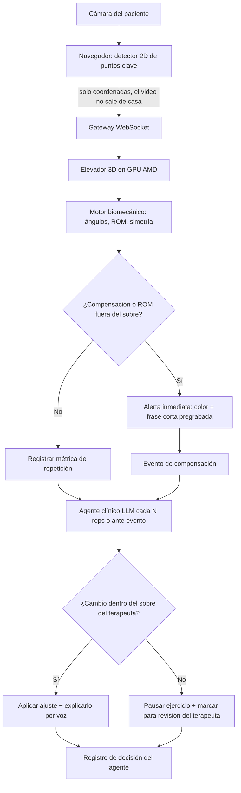
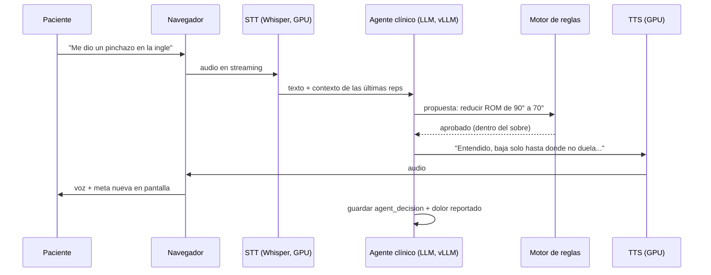
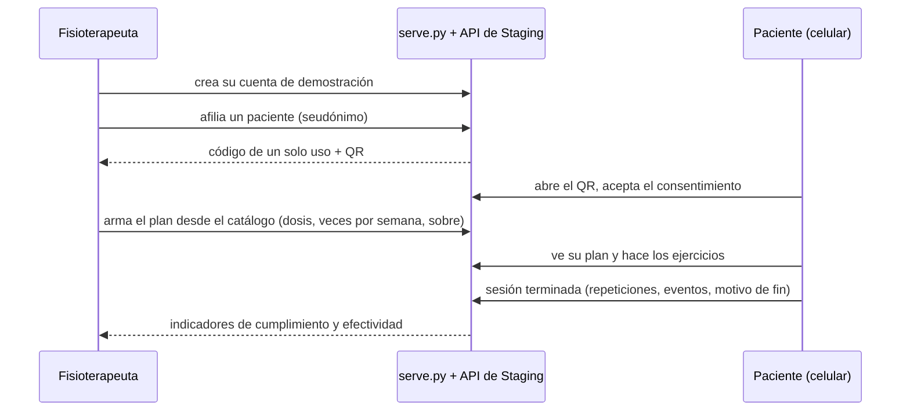

# 01 · Lógica del sistema

> Proyecto: **AXONFAS** · Entorno actual: **Staging** · Actualizado: 2026-10-11
> Estado de implementación: diseño. Solo existe el prototipo de validación del navegador (sección al final); el sistema
> completo todavía no tiene código.

## Idea central

El sistema trabaja con **dos bucles separados**. Esta es la decisión técnica más importante del proyecto, porque de ella depende que sea seguro para un paciente ([ADR-004](04-decisions-adr.md)).

| Bucle | Qué hace | Quién decide | Latencia objetivo |
|---|---|---|---|
| **Rápido (seguridad)** | Detecta una compensación o un ángulo fuera de rango y avisa en el momento | Motor de reglas biomecánicas (determinista) | < 250 ms |
| **Lento (razonamiento)** | Ajusta series, rango y pausas, y responde lo que dice el paciente | Agente clínico (LLM) | 1–2 s |

El LLM **nunca** está en el camino de una alerta de seguridad. Solo puede mover parámetros dentro del **sobre de seguridad** (`safety_envelope`) que el fisioterapeuta definió en el plan de cuidado ([ADR-005](04-decisions-adr.md)).

## Flujo de una repetición

## Detección de cadena de compensación (diferenciador)

Las apps actuales miden **una** articulación contra un umbral. AXONFAS mide **la relación entre segmentos**: cuando el ángulo objetivo mejora pero otro segmento empieza a desviarse, eso es compensación.

Regla base para el demo (sentarse y pararse / sentadilla, [ADR-009](04-decisions-adr.md)):

1. `rodilla_flexión` alcanza el rango pedido **y**
2. `tronco_flexión` sube más de X° respecto a la línea base del paciente **o**
3. `rodilla_valgo` supera Y° **o**
4. `asimetría_carga` izquierda/derecha supera Z%

→ se genera un `compensation_event` con tipo, severidad (1–3) y la repetición donde ocurrió.

Los umbrales X, Y, Z **no se inventan**: se toman de la línea base de calibración del propio paciente (primeras 3 repeticiones) y los ajusta el fisioterapeuta.

## Turno de voz

## Reglas del agente clínico

- Si el paciente reporta **dolor agudo, mareo o pérdida de fuerza súbita** → detener la sesión y mostrar el mensaje de contactar al profesional. No se intenta "resolverlo".
- El agente propone cambios en formato estructurado: JSON `{param, old, new, reason}` (parámetro, valor anterior, valor nuevo y motivo), el mismo que guarda `agent_decision.proposal`. El motor de reglas los valida contra el sobre. Esquema completo en [06 · API y MCP](06-api-mcp.md).
- Todo cambio queda en `agent_decision` con su motivo, para auditoría del terapeuta.

## Fin de sesión

1. Consolidar métricas por repetición → resumen de sesión.
2. El LLM redacta un borrador de **nota SOAP** con datos reales de la sesión (no inventa cifras: solo usa campos de la BD).
3. Exportar como `Observation` FHIR R4 + PDF ([ADR-008](04-decisions-adr.md)).
4. Sumar el día al periodo de monitoreo (`monitoring_period.days_with_data`) para el modelo de negocio RTM.

## Invariantes

Resumen de lo que el código nunca puede violar. Cada uno sale de las secciones anteriores, de un ADR o de las reglas de integridad de [03 · Base de datos](03-database.md).

| # | Invariante | Origen |
|---|---|---|
| I-1 | El LLM nunca decide ni retrasa una alerta de seguridad: la alerta la emite solo el motor de reglas | ADR-004 |
| I-2 | Ningún ajuste del agente se aplica fuera del `safety_envelope`: `outcome = 'applied'` exige `within_envelope = true` | ADR-005, 03 |
| I-3 | Sin `consent_given` no se crea una sesión, y sin sobre configurado no se inicia | ADR-005, 03 |
| I-4 | El video no sale del navegador: al servidor solo llegan coordenadas 2D (y el audio de voz) | ADR-003 |
| I-5 | Los umbrales de compensación salen de la línea base del paciente (3 reps) y los ajusta el terapeuta | Esta pestaña |
| I-6 | La nota SOAP solo usa campos de la BD; nunca cifras inventadas | Esta pestaña |
| I-7 | Dolor agudo, mareo o pérdida de fuerza súbita detienen la sesión; el agente no intenta resolverlo | Esta pestaña |
| I-8 | Un reporte sin `reviewed_by` es borrador y no se exporta fuera de Staging | ADR-008, 03 |
| I-9 | No se registra una sesión de un ejercicio que no esté en el plan activo del paciente; en los monitoreados, el sobre lo fija el fisioterapeuta y el paciente no lo puede cambiar | ADR-005, ADR-012 |
| I-10 | Un fisioterapeuta solo ve y modifica a sus propios pacientes; a cualquier otro la API le responde "no existe" | ADR-012 |
| I-11 | El canal en vivo lleva ángulos o la medida del ejercicio, el avance, la fase, las repeticiones, los eventos y hasta 15 puntos 2D; nunca video ni imágenes | ADR-003, ADR-013, ADR-014 |
| I-12 | El seguimiento de la galería solo cuenta: no emite alertas de compensación. Las alertas son solo del motor de reglas de sentarse y pararse | ADR-004, ADR-009, ADR-014 |

## Reglas de seguridad de la pista Health and Wellbeing

AXONFAS compite en la pista 2 del AMD Developer Hackathon: ACT III (brief revisado el 2026-10-06). El brief exige que el
producto no presente diagnóstico ni tratamiento autónomo como consejo médico, que haga visible la incertidumbre y que
sepa cuándo una persona debe revisar o tomar el caso. Así responde el diseño a cada punto que pide explicar:

| Lo que pide el brief | Cómo lo resuelve AXONFAS | Origen |
|---|---|---|
| Sin diagnóstico ni tratamiento autónomo | El plan lo prescribe el fisioterapeuta; el agente solo ajusta dentro de su sobre; el reporte es borrador hasta que lo firma | ADR-005, ADR-008 |
| Respuestas incorrectas o sin soporte | El agente solo propone en JSON y el motor de reglas valida; la nota SOAP solo usa campos de la BD | I-2, I-6 |
| Información sensible | El video no sale de casa; pacientes con seudónimo; en Staging solo datos sintéticos | ADR-003, ADR-010 |
| Resultados inciertos | **Pendiente:** mostrar la confianza de la pose y definir qué pasa con los frames de baja confianza | TD-25 |
| Decisiones de alto riesgo | Alertas deterministas fuera del LLM; dolor agudo, mareo o pérdida de fuerza detienen la sesión; un cambio fuera del sobre pausa el ejercicio | I-1, I-7 |
| Revisión humana | `outcome = 'escalated_to_therapist'` marca el caso para el terapeuta, que aprueba la nota SOAP en el panel | ADR-005, TD-09 |

## Prototipo de validación (TD-28)

Versión mínima del bucle rápido que corre solo en el navegador, para validar con fisioterapeutas el ejercicio, las dos
compensaciones y el sobre (TD-06). Código en `src/frontend/validation-prototype/`; tests en `tests/validation-prototype/`.
No usa GPU, LLM ni voz de entrada, y no guarda nada.

| Paso | Regla implementada | Valor de partida (a validar) |
|---|---|---|
| Ángulos | Flexión de rodilla (3D), flexión de tronco contra la vertical y proxy de valgo, con los puntos "world" de MediaPipe en lugar del lifter de ADR-006 | — |
| Repetición | Empieza cuando la rodilla baja del umbral de sentado y termina al volver a sentarse habiendo llegado a estar de pie; si no llegó a pararse, no cuenta | Sentado ≥ 65°, de pie ≤ 25° |
| Línea base | Media de los picos de las 3 primeras repeticiones válidas (I-5). Una repetición con más del 20 % de frames dudosos no sirve para calibrar y se repite | 3 repeticiones |
| Umbrales | Línea base + margen del terapeuta para tronco (X) y valgo (Y); rango pedido = línea base − 10° si el terapeuta no lo fija | X = 15°, Y = 10° |
| Compensación | Solo se evalúa si la repetición alcanzó el rango pedido. Un evento por tipo y lado en cada repetición: la alerta sale en el primer frame que cruza el umbral y el evento guarda el pico | — |
| Severidad | Según cuánto supera el umbral el pico de la repetición | 1 si < 5°, 2 si < 10°, 3 si más |
| Incertidumbre | Si la menor visibilidad de los puntos clave baja del mínimo, el frame no se evalúa, se avisa y la repetición queda marcada (adelanto de TD-25) | 0.6 |
| Fin | `completed` al llegar a las repeticiones pedidas, `pain_stop` con el botón de dolor (I-7), `user_quit` al terminar a mano | 10 repeticiones |

El proxy de valgo mide cuánto se desplaza la rodilla hacia la línea media respecto de la línea cadera-tobillo, solo en el
eje horizontal, y lo expresa en grados contra la longitud de la pierna. Así no le afecta que el muslo apunte a la cámara
al estar sentado, pero necesita ver a la persona de frente o casi.

## Galería de ejercicios (ADR-011)

24 ejercicios en cuatro temáticas: rodilla y cadera, columna lumbar y cervical, hombro, y equilibrio y caídas. Cada uno
cita su fuente pública y la dosis que esa fuente indica; el fisioterapeuta la ajusta al armar el plan.

| Monitoreo | Ejercicios | Qué hace el sistema |
|---|---|---|
| Automático | Sentarse y pararse (la prueba de 30 s de CDC STEADI) | Cámara, motor de reglas, línea base y alertas (secciones anteriores) |
| Seguimiento con cámara | Los 24, incluido sentarse y pararse (ADR-014) | Esqueleto, medida del ejercicio, conteo de repeticiones o sostenes y mapa muscular según el avance. Sin detección de compensaciones (sección siguiente) |
| Guiado sin cámara | Los otros 23, como alternativa | Muestra pasos, músculos y huesos; cuenta series y el tiempo de sostén; el paciente marca cada serie |

## Seguimiento con la cámara (ADR-014)

`tracker.js` mide un valor por frame con los puntos "world" de MediaPipe y cuenta según el modo del ejercicio. Todos los
números son valores de partida, no clínicos (TD-48). Código y valores por ejercicio en `SPECS`; tests en
`tests/validation-prototype/tracker.test.cjs`.

| Modo | Ejercicios | Regla |
|---|---|---|
| Repeticiones | Sentadilla parcial, extensión y flexión de rodilla, elevación de talones y de pierna recta, abducción de cadera, almeja, rodilla al pecho, puente, perro de caza, retracción cervical, inclinación del cuello, rotación de tronco, péndulo, rotaciones con banda, remo, sentarse y pararse | Primero toma la posición inicial: el valor quieto durante 1 s. Una repetición cuenta al alejarse el recorrido pedido (`delta`) en el sentido del ejercicio y volver a menos del 35 % de ese recorrido. Si llega a la mitad pero no al total, es una repetición incompleta y no cuenta. **Si la dosis pide sostener, la repetición solo cuenta si se mantuvo dentro del 80 % del recorrido hasta que la cuenta llegó a 0**: los cortes de menos de 0,4 s (ruido de la pose) no reinician la cuenta, pero bajar más tiempo sí. Si baja antes, avisa cuánto sostuvo y no cuenta |
| Sostén | Postura en tándem, apoyo en un pie, estiramiento de isquiotibiales, estiramiento cruzado del hombro | Cuenta el tiempo mientras se cumple la condición (por ejemplo, el pie a 5 cm o más del suelo). Al llegar al tiempo de la dosis, suma uno. Los cortes de menos de 0,4 s no reinician el sostén |
| Manual | Activación abdominal, retracción escapular | La cámara no ve el músculo. La persona toca "Sostener" y el sostén cuenta solo si la cámara la sigue viendo hasta el final; si la pierde más de 1,5 s, se cancela |

- **De un lado o de los dos:** las medidas de un lado usan el lado que más se mueve (flexión de rodilla de pie) o el
  promedio de los dos (sentadilla). Los ejercicios "por lado" (cuello, rotación de tronco, estiramiento cruzado) cuentan
  ambos lados en la meta de cada serie.
- **Incertidumbre:** si la visibilidad de los puntos de la medida baja de 0,5, el frame no cuenta y se avisa "no te
  veo bien". Durante el reposo, la posición inicial sigue despacio a la persona, solo dentro del 15 % del recorrido
  pedido.
- **Aproximados:** 14 ejercicios se siguen peor porque se hacen acostados, de perfil o con la profundidad que estima
  la cámara. La página lo avisa e indica dónde poner la cámara.
- **Qué ve la persona:** una figura de referencia propia (`guide-figure.js`) con la posición inicial, el movimiento, el
  sostén y la vuelta, junto al video, en "Cómo se hace", en cada tarjeta de la galería y en el plan del paciente. La
  indicación de cada fase sale de los mismos textos: "Levanta la pierna de arriba" → "Sostén: 3 s" → "¡Bien! Ahora
  baja" → vuelta. La cuenta del sostén aparece grande sobre el video, legible a 2–3 m.
- **Series:** meta por serie = repeticiones de la dosis (×2 si es por lado). La dosis sale del plan del fisioterapeuta
  o, sin plan, de la fuente. Al cerrar cada serie se anuncia un descanso; al llegar al total, la sesión termina como
  `completed`.

## Cuentas y seguimiento (ADR-012)

Indicadores, descriptivos y no clínicos, calculados en `compute_metrics`:

| Indicador | Cálculo |
|---|---|
| Cumplimiento (7 días) | Por ejercicio del plan: sesiones completadas en 7 días ÷ veces por semana indicadas, con tope 1. Se promedia entre ejercicios |
| Calidad | En la última sesión monitoreada: repeticiones de ejercicio (sin las de calibración) sin compensación ÷ repeticiones de ejercicio |
| Tendencia de calidad | Promedio de las 3 últimas sesiones monitoreadas menos el de las 3 primeras; requiere 4 o más |
| Rodilla (ROM) | Flexión media de rodilla en las repeticiones de ejercicio, primera y última sesión monitoreada |
| Detenciones por dolor | Sesiones con `end_reason = 'pain_stop'` en 30 días: bandera roja para el fisioterapeuta |

## Vista corporal en vivo (ADR-013)

El paciente publica cada ~200 ms los ángulos, la fase, las repeticiones y 9 puntos 2D (nariz, hombros, caderas, rodillas
y tobillos). Con el seguimiento de la galería (ADR-014) publica además la medida del ejercicio, el avance (0 a 1) y 15
puntos (suma orejas, codos y muñecas). El fisioterapeuta ve:

- **Mapa muscular** (frente y espalda) con la carga **estimada**. En sentarse-pararse, la flexión de rodilla carga el
  cuádriceps y los glúteos, la inclinación del tronco carga los isquiotibiales y la zona lumbar, y el valgo pone en foco a
  los abductores (glúteo medio). En los demás ejercicios se encienden los músculos del catálogo, más intensos a medida
  que la persona llega al recorrido pedido (con seguimiento) o fijos (guiado sin cámara). Ante una compensación
  se marcan en rojo durante 3 s los músculos donde mirar: zona lumbar y glúteos para el tronco, abductores y glúteos para
  el valgo.
- **Esqueleto** con los huesos rotulados (fémur, tibia y peroné, pelvis, columna, columna cervical, clavículas y
  escápulas, húmero, cúbito y radio), los ángulos o la medida del ejercicio,
  la fase, el conteo de repeticiones y el registro de alertas.
- **Enseñanza:** al tocar un músculo o enviar un ejercicio, al paciente le aparece en su pantalla el mapa con lo que
  trabaja y los huesos que mueve.

La estimación de carga es educativa: no hay electromiografía y no es un diagnóstico (TD-43).
