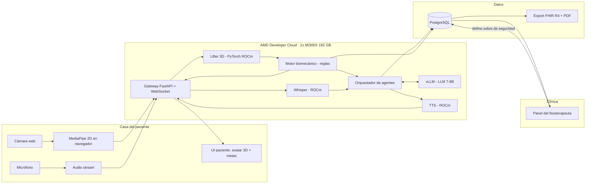
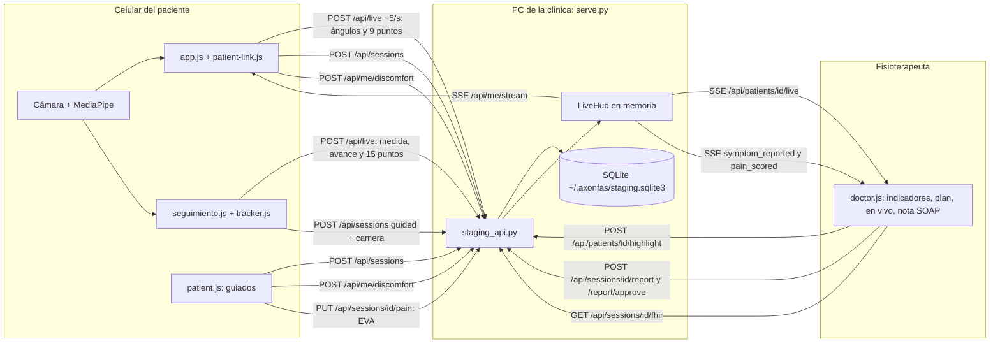
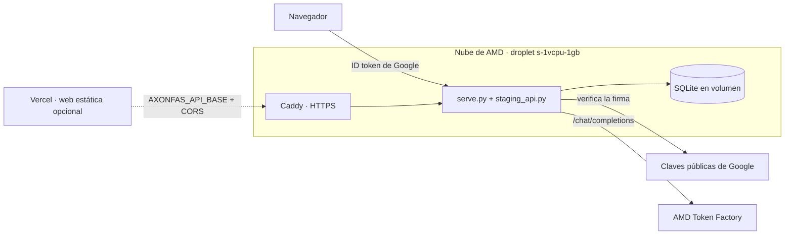
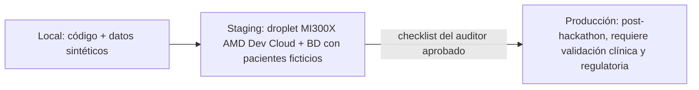

# 02 · Arquitectura

> Proyecto: **AXONFAS** · Entorno actual: **Staging** · Actualizado: 2026-10-18
> Estado de implementación: en `src/` hay el prototipo de validación (con cuentas de demostración, vista en vivo, nota
> SOAP y export FHIR en la red local, sección "Staging local"), los agentes y la pila de la GPU listos para correr
> (ADR-016), el aviso de molestias y el descanso recomendado (ADR-021/019) y el generador del panel de contexto. Falta lo que corre en la GPU (TD-04), el lifter 3D (TD-05) y el
> gateway de la nube (TD-45).

## Tecnologías (explicadas simple)

| Pieza | Tecnología | Para qué sirve |
|---|---|---|
| Captura | MediaPipe Pose en el navegador | Saca 33 puntos del cuerpo en 2D sin enviar el video |
| Transporte | WebSocket (FastAPI) | Envía coordenadas y audio en tiempo real |
| Pose 3D | Modelo "lifter" 2D→3D en PyTorch sobre **ROCm** | Recupera profundidad y rotaciones que el 2D pierde |
| Reglas | Python (NumPy) | Alertas de seguridad deterministas y rápidas |
| Agente clínico | LLM abierto 7–8B servido con **vLLM en ROCm** | Razona, ajusta la sesión, redacta la nota SOAP |
| Voz entrada | Whisper (PyTorch, ROCm) | Voz → texto |
| Voz salida | TTS abierto ligero (PyTorch, ROCm) | Texto → voz natural |
| Datos | PostgreSQL | Pacientes, sesiones, eventos, decisiones |
| Interoperabilidad | FHIR R4 | Que cualquier sistema clínico lea el reporte |
| Cómputo | **AMD Developer Cloud · 1× Instinct MI300X (192 GB HBM3)** | Todos los modelos juntos en una sola GPU |

**ROCm** es el equivalente de AMD a CUDA: permite correr PyTorch y vLLM sobre GPUs AMD sin cambiar el código del modelo.

Por elegir: el modelo lifter y su licencia (TD-05, candidatos abajo). Que el LLM, Whisper y el TTS caben juntos en la GPU se prueba en TD-04.

### Candidatos para el lifter 2D→3D (TD-05, revisado 2026-10-08)

Hay dos licencias distintas que revisar:

- **Código:** MotionBERT y MotionAGFormer son Apache-2.0 y PoseFormerV2 es MIT. Las tres permiten uso comercial.
- **Pesos preentrenados:** ningún repo les declara una licencia propia, y se entrenaron con datasets de uso académico
  (Human3.6M: "academic use only"; MPI-INF-3DHP y AMASS: investigación no comercial). Esas licencias no dicen nada
  explícito sobre modelos entrenados con sus datos, así que es un riesgo legal sin resolver, no una prohibición. Para el
  demo del hackathon basta. Para Producción hace falta revisión legal, licencia comercial del dataset o reentrenar con
  datos propios o con licencia.

**Latencia:** el lifter está dentro del bucle rápido (< 250 ms). Estos modelos procesan ventanas de frames; si se usa la
predicción del centro de la ventana hay que esperar frames futuros (a 30 fps, una ventana de 27 frames centrada espera
≈ 0.45 s). Recomendación: empezar con MotionAGFormer-XS usando la predicción del último frame de la ventana y medir su error
contra la ventana completa. La elección es del equipo.

| Opción | Código | Pesos entrenados con | Ventana | Notas |
|---|---|---|---|---|
| MotionAGFormer-XS | Apache-2.0 | Human3.6M o MPI-INF-3DHP | 27 frames | 2.2 M parámetros, 1.0 GMACs. Primer candidato para el bucle rápido |
| MotionBERT-Lite | Apache-2.0 | Human3.6M, AMASS, PoseTrack, InstaVariety | Hasta 243, variable | 61 MB. Repo activo (último cambio 2026-03) |
| MotionAGFormer-S / B / L | Apache-2.0 | Human3.6M o MPI-INF-3DHP | 81 o 243 frames | Más precisos y más lentos que XS |
| PoseFormerV2 | MIT | Human3.6M | Variable | Último cambio 2025-02 |
| VideoPose3D | CC BY-NC 4.0 | Human3.6M | Variable | Repo archivado. Descartado: el código no permite uso comercial |
| MediaPipe world landmarks (sin lifter) | Apache-2.0 | Modelo propio de Google | 1 frame | 3D en metros con origen en las caderas, en el navegador. Profundidad menos precisa: respaldo, no reemplaza al lifter de ADR-006 |

Los lifters esperan los 17 puntos del formato Human3.6M: hay que mapear los 33 puntos de MediaPipe.

## Por qué AMD es parte del producto y no solo "donde corre"

La tesis es **"toda la clínica en una GPU"** ([ADR-006](04-decisions-adr.md)): los 192 GB de memoria de la MI300X permiten tener cargados al mismo tiempo el LLM, Whisper, el TTS y el modelo de pose, y atender **muchas sesiones de pacientes en paralelo**. Eso define el costo por sesión, que es la métrica de negocio:

```
costo_por_sesión = (precio_GPU_hora × duración_sesión_h) / sesiones_concurrentes
```

Con la MI300X a USD 1.99/h y una sesión de 20 min, el numerador es ≈ USD 0.66. El entregable técnico del hackathon es **medir `sesiones_concurrentes`** manteniendo el bucle rápido < 250 ms (benchmark real, no estimado; TD-08).

El precio de USD 1.99/h lo confirma una medición pública del 2026-09-16 en el tamaño `gpu-mi300x1-192gb-devcloud`, región
`atl1`. La página de precios de DigitalOcean (verificada en junio de 2025) todavía dice USD 2.59/h y está desactualizada.

## Diagrama de componentes



## Agentes (reducidos de 5 a 3 + 1 motor)

La versión anterior tenía 5 agentes LLM. Se reduce porque varios no necesitan un LLM y eso mete latencia y riesgo ([ADR-007](04-decisions-adr.md)):

| Antes | Ahora | Motivo |
|---|---|---|
| Agente de cinemática 3D | **Servicio de pose** (modelo, no agente) | Es inferencia pura, no razona |
| Agente biomecánico | **Motor de reglas** (determinista) | La seguridad no puede depender de un LLM |
| Agente clínico razonador | **Agente clínico** (LLM) | Se mantiene, es el núcleo |
| Agente de voz | **Agente conversacional** (STT + LLM + TTS) | Se mantiene |
| Agente de telemetría | **Agente de reporte** (LLM, al final de la sesión) | Redacta SOAP con datos reales |

## Carpetas del proyecto

Estructura de `_Plantilla Proyecto IA`. Cada componente del diagrama tiene una carpeta asignada; el detalle interno se decide al escribir el código.

| Carpeta | Contenido |
|---|---|
| `.ai-context/` | Estas seis pestañas, `README.md` y `llms.txt` |
| `src/frontend/` | UI del paciente (MediaPipe 2D, micrófono, avatar 3D y metas) y panel del fisioterapeuta |
| `src/frontend/validation-prototype/` | Prototipo de validación y demo de cuentas. Páginas: `index.html` (cámara y motor de reglas; con `?plan=` entra en modo paciente vía `patient-link.js`, que aplica en vivo una baja por molestia con `window.AxonApp`), `galeria.html` (catálogo, ADR-011), `seguimiento.html` (cámara y conteo para cualquier ejercicio de la galería; con `?plan=1` en modo paciente, ADR-014), `doctor.html` (fisioterapeuta, ADR-012/013) y `paciente.html`. Módulos: `engine.js` (reglas), `tracker.js` (medida y conteo por ejercicio, sin alertas), `guide-figure.js` (componente "Figura de referencia" del design system: marioneta muscular animada en 3D de cada ejercicio: esqueleto con ángulos anatómicos, cámara en tres cuartos, orden por profundidad y polígonos de músculos `SHAPES` (perfil, frente y espalda de cada segmento, según cómo lo ve la cámara), tokens `--muscle-*` (compartidos con el mapa muscular) y `--fig-*`, y la clase `.fig`; es la única referencia visual de los ejercicios en todas las páginas: Prototipo, galería, seguimiento, plan y vista guiada del paciente, panel del fisioterapeuta y aviso de enseñanza), `seguimiento.js` (su página: esqueleto, contador, mapa y envío al fisioterapeuta, con el detalle de cada repetición al guardar), `pose-camera.js` (cámara y MediaPipe Pose 1.1.0 compartidos por `app.js` y `seguimiento.js`: carga el modelo una vez, abre la cámara con avisos claros y corre el bucle de detección; TD-50), `suggestions.js` (sugerencias por rol, encaje de cada ejercicio con el perfil del paciente y los componentes `.suggest` y del formulario del perfil; ADR-017), `camera-setup.js` (preparar la cámara antes de cada sesión: alternativas con la calidad de cada medida, chequeo en vivo de encuadre, distancia y ángulo, y qué no se evalúa desde la vista real; ADR-015), `synthetic.js` (sesiones sintéticas), `app.js` (Prototipo: preparación, motor de reglas, guía, contador y avisos legibles a 2–3 m; emite eventos `axon:*`), `catalog.js` (24 ejercicios con fuente), `body-map.js` + `body-map-data.js` (mapa muscular 2D, polígonos MIT), `api-client.js`, `teach-toast.js`, `share.js` (QR), `gallery.js`, `doctor.js`, `patient.js`, `symptom-form.js` (formulario "Tengo una molestia" del paciente, sin GPU; ADR-021), `rest-timer.js` (cuenta regresiva del descanso recomendado, que se puede saltar o alargar; ADR-022), `env-banner.js` (aviso de entorno, Demo pública o Plataforma clínica, y color de la cabecera; ADR-033), `practice.js` (tutorial "Mira y sigue" y rutina sin cámara con conteo manual; ADR-029), `auth-wall.js` (barra del invitado y muro de autenticación diferido; ADR-028), `demo-telemetry.js` (resultados anónimos de la demo pública; ADR-028), `triage.js` (Nivel 1: descargo médico y triaje de banderas rojas antes de la galería, el seguimiento libre y el Prototipo sin plan; se activa con `data-gate="self-care"`, sin red ni IA; ADR-023), `twin.js` (gemelo digital del Prototipo: esqueleto en espejo con los tokens y guía de corrección durante una alerta; TD-101), `empresa.html` + `empresa.js` (panel de empresa del Nivel 3: plan, licencias, pacientes por profesional y dirección FHIR; ADR-026), `care-plan.js` (Nivel 2: qué toca hoy según `per_week` y las sesiones completadas, en la hora local, con reglas fijas; ADR-025) y `pain-scale.js` (EVA 0–10 al terminar cada sesión en `paciente.html`, `seguimiento.html` e `index.html?plan=`; ADR-025), e `i18n.js` (idioma de la interfaz: detección por el navegador, selector ES / EN de la cabecera, `t()`, `data-i18n`, voz y fechas; ADR-030) con sus diccionarios en `i18n/`, uno por área (`common.js`, `session.js`, `routine.js`, `library.js`, `clinic.js`, cada uno con los bloques `es` y `en`, y `catalog.en.js`, el catálogo en inglés; `library.js` trae además, en `data.guides`, el texto de cada fase de las figuras de referencia, porque `GUIDES` de `guide-figure.js` no cambia de forma). `catalog.js` arma copias traducidas al cargar y nunca toca el original, que el servidor lee en español (`load_names`); los nombres en inglés los lee de `i18n/catalog.en.js` (`load_names_en`). `api-client.js` manda el idioma en `Accept-Language` (también en el canal en vivo) y el servidor responde en él (ADR-032); `serve.py` admite esa cabecera en CORS. Cada página carga los diccionarios y luego `i18n.js` antes que sus otros scripts, para que todo salga traducido desde el inicio. `tracker.withGoal` aplica la meta de recorrido del plan en modo paciente (ADR-025). `engine.js` mide el valgo en un marco de la pelvis normalizado por el ancho de cadera (ADR-024). Estilos: tokens de `docs/design-system/tokens.css` y componentes compartidos en `hud.css`, incluidos el escenario de cámara (video, avisos, contador y botonera) que usan `index.html` y `seguimiento.html` y la figura de referencia (`.fig`, design system §4); cada página solo agrega lo suyo. En celular los tacómetros pasan debajo del video. `serve.py` sirve todo en la red local con QR y la API de Staging; `lanzar-prototipo.cmd` lo arranca con doble clic. `preview.html` es una copia vieja pendiente de borrar (TD-37). Lógica en [01](01-logic.md) |
| `tests/validation-prototype/` | Tests del motor, del catálogo, de la estimación de carga, del seguimiento (medidas, repeticiones, sostenes, modo manual) de las figuras de referencia (apoyo en el suelo, manos en la silla, una figura por ejercicio, animar o pausar), de la preparación de la cámara, del módulo de cámara compartido y del panel del fisioterapeuta (`doctor.test.cjs`: rango del sobre, nota SOAP accesible, textos de borrador y "sin IA", descarga FHIR) con `node --test` (sin dependencias), sobre sesiones y poses sintéticas. También `symptom.test.cjs` (formulario de molestias: opciones, accesibilidad y unión a la sesión) `rest.test.cjs` (cuenta del descanso y textos de valor de partida), `triage.test.cjs` (banderas, bloqueo, vigencias, exentos, sin red ni IA, accesibilidad), `twin.test.cjs` (guías de corrección del gemelo, sin texto ni red, colores de los tokens), `ui-audit.test.cjs` (entorno por página y cuenta, cabecera estable, tarjetas en celular, tamaño de la cámara y preparación sin nadie a la vista), `practice.test.cjs` (conteo manual, motivos sin cámara, tutorial por ejercicio, textos del panel y la nota) y `guest.test.cjs` (invitado, muro, demo pública con solo números) y `care-plan.test.cjs` (agenda del día por frecuencia, EVA accesible en las tres páginas, umbral compartido con la API; ADR-025). `tracker.test.cjs` prueba además la meta y el límite del plan. `i18n.test.cjs` revisa el idioma (ADR-030): mismas claves en español y en inglés, ninguna repetida entre paquetes, cada `data-i18n` de cada página y cada `t()` de los scripts en los dos idiomas, la detección por el navegador, la prioridad de la elección manual, el selector accesible y que las urgencias citen el 106 y el número del país en los dos idiomas. `engine.test.cjs`, `camera.test.cjs`, `pose-camera.test.cjs`, `catalog.test.cjs`, `guide.test.cjs` y `guest.test.cjs` revisan además sus textos en inglés: la voz de las alertas dice lado y dirección, "No veo…" arma la lista en el idioma, los 24 ejercicios con las mismas dosis y posiciones de precaución, y las figuras con las mismas fases. `engine.test.cjs` prueba además el valgo en el marco de la pelvis: estatura, distancia, cámara en diagonal y el demo girado 30° |
| `tests/backend/` | Tests de la API de Staging con `unittest` y SQLite en memoria (incluidos nota SOAP, firma, revocación de tokens, molestias del paciente, descanso recomendado, meta de recorrido, historial para la agenda y EVA al terminar), del export FHIR (`test_fhir.py`: estructura R4, unidades UCUM, `preliminary`/`final`, sin datos personales; `test_fhir_document.py`: la nota SOAP como `Bundle` de tipo documento, referencias que resuelven, LOINC, firma y custodio), del Nivel 3 (`test_organizations.py`: planes, licencias, dirección FHIR y resumen sin datos clínicos; `test_org_api.py`: la API de organizaciones, el documento FHIR por API y la migración de roles del token), de la sesión sin cámara (`test_no_camera.py`: bandera del servidor, sin métricas, nota, FHIR y migración) y del invitado y la demo pública (`test_guest_demo.py`: muestra de solo lectura, `auth_required`, números anónimos, tope por hora), del idioma del servidor (`test_server_lang.py`: cabecera, traducción de todo `ApiError`, mensajes al paciente, nota SOAP y FHIR en inglés con los mismos datos y códigos, borrador leído en otro idioma y firma, muro con motivo, muestra en los dos idiomas, resumen con IA en inglés y migración) y del benchmark con operaciones de mentira |
| `tests/agents/` | Tests de los agentes sin GPU: alarmas (también en inglés, `test_safety_en.py`), sobre (límites del fisioterapeuta y regla de dirección tras una molestia), traducción del sobre de Staging, clasificación de molestias, reducción determinista y respaldo del motor de reglas, propuestas rotas, números inventados (en cifras y en letras), nota SOAP (también en inglés con las mismas cifras y el resumen con IA en los dos catálogos, `test_report_lang.py`) y la conexión HTTP contra servidores de mentira con la forma de vLLM y del servidor de voz |
| `src/frontend/context-panel/` | Generador del panel de contexto: `build_panel.py` (solo biblioteca estándar) convierte estas seis pestañas en una página HTML con `template.html` (tema claro y oscuro; tablas con borde y cabecera de contraste ≥ 3:1 y filas alternadas, TD-60). La salida va a `dist/` (no se versiona) y se publica como artifact |
| `src/axonfas-video-presentation/` | Video de presentación en inglés generado con código (ADR-027): Remotion 4 (React + TypeScript; `package.json` y `package-lock.json` con versiones fijadas), una escena por fase del guion en `src/axonfas-video-presentation/src/scenes/` (Problem, Capture, Brain, Impact), figura de sentarse y pararse en 3D y mapa muscular propios (`figure.tsx` y `bodymap.tsx`) con los tokens de `docs/design-system/tokens.css`, guion único en `script/voiceover.json` (subtítulos y TTS) y voz en off con Kokoro-82M en ONNX en la CPU (`tts/narrate.py`, `kokoro-onnx`; sin Kokoro, las voces de Windows). `video.py` (solo biblioteca estándar) copia todo a `~/.axonfas/video-presentation`, fuera de Drive y del repo, donde quedan `node_modules`, el venv, el modelo, el audio y el `.mp4`. Comandos en su README |
| `src/backend/` | Hoy: `staging_api.py`, la API de Staging (cuentas de demostración, planes, sesiones, indicadores, canal en vivo y nota SOAP con borrador y firma; ADR-012/013, TD-09); `fhir.py`, la `Observation` FHIR R4 de cada sesión y la nota SOAP como `Bundle` de tipo documento (funciones puras, sin estado; TD-10, TD-103); `organizations.py`, planes, licencias y resumen del Nivel 3 (funciones puras; ADR-026); `messages.py`, el idioma de lo que escribe el servidor: `lang_of` lee `Accept-Language` y `tr` traduce a la salida los mensajes escritos en español con la tabla de plantillas `EN` (ADR-032). `soap.py` y `fhir.py` reciben el idioma; la API lo guarda por petición en un `threading.local` y lee los nombres en inglés de `i18n/catalog.en.js` (`load_names_en`); `gpu/`, lo que corre en la MI300X (ADR-016): `bootstrap.sh` (prepara el contenedor `rocm` y arranca vLLM y la voz), `run.sh`, `voice_server.py` (Whisper y Kokoro en PyTorch sobre ROCm), `smoke.py` (prueba de humo) y `bench.py` (sesiones concurrentes); `cloud/axonfas-cloud.ps1`, el ciclo del droplet con `doctl`. Planificado: gateway FastAPI + WebSocket, servicio de pose (lifter 3D), motor biomecánico de reglas, servicios STT/TTS, acceso a PostgreSQL y el PDF de la nota (TD-84) |
| `src/agents/` | Los tres agentes LLM y sus reglas deterministas, solo biblioteca estándar (ADR-016): `safety.py` (frases de alarma y de molestia en español y en inglés, para que el texto libre detenga igual con la interfaz en inglés (ADR-030), validación contra el sobre, regla de dirección tras una molestia, `classify_symptom`, `reduce_demand` y `symptom_record` (ADR-021) y `agent_envelope`, que traduce el sobre de Staging), `clinical.py`, `coach.py`, `soap.py`, `turn.py` (turno de voz completo y demo con `--fake`; `run_text_turn`, el turno de texto del paciente con tiempo límite, ADR-033), `llm.py` (cliente de vLLM compatible con OpenAI y LLM de mentira) y `voice.py` (cliente del servidor de voz), `advisor.py` (resumen con IA de las sugerencias para el fisioterapeuta, con controles de cifras y ejercicios; ADR-017), `providers.py` (proveedor de IA de AMD: Token Factory o vLLM propio, con contador de uso; ADR-018), `privacy.py` (filtro determinista de datos personales antes de cualquier LLM; ADR-034) |
| `tests/` | Pruebas del motor de reglas y del sobre de seguridad, benchmark de latencia y concurrencia, validación FHIR |
| `config/` | Plantillas de entorno sin valores: `config/.env.staging.example` y `config/.env.prod.example` |
| `data/` | Solo datos sintéticos o del equipo con consentimiento (`raw/`, `processed/`, `vector_store/`). Nunca se versiona |
| `notebooks/` | Experimentos: calibración de umbrales, pruebas del lifter |
| `docs/` | `design-system/` (HUD Biónico: `docs/design-system/tokens.css` y su README, aceptado por el equipo el 2026-10-08) y `meetings/` (privado, fuera del repo) |

Archivos raíz permitidos: `README.md`, `CLAUDE.md`, `.gitignore` y `.gitattributes` (LF en todo el repo, CRLF en
`.cmd`). Repo público: https://github.com/JoseFM2808/AXONFAS, rama `main`.

## Staging local: cuentas y vista en vivo (ADR-012, ADR-013)



- Todo va en el mismo origen que el prototipo (HTTP 8091 en el PC, HTTPS 8443 en la red local). Contrato en
  [06 · API y MCP](06-api-mcp.md) y tablas en [03 · Base de datos](03-database.md).
- Los canales en vivo se leen con `fetch`, con el token en la cabecera `Authorization` y nunca en la URL. Si el servidor
  se reinicia, se reconectan solos.
- **En la nube** (fase siguiente), el gateway FastAPI en AMD Developer Cloud ocupa el lugar de `serve.py`, PostgreSQL el
  de SQLite y el canal en vivo pasa por WebSocket. Las páginas y el contrato de datos no cambian.

## Cuentas, IA y despliegue (ADR-018, ADR-019, ADR-020)



- **IA:** Token Factory expone `https://developer.amd.com.cn/radeon/api/v1` (compatible con OpenAI). La clave es una
  por equipo con límites por clave, así que `llm.py` reintenta dos veces ante 429 (respeta `Retry-After`, máximo 5 s) y
  `providers.py` nunca elige solo un modelo que no conversa (OCR, embeddings). `AMD_TOKENFACTORY_MODEL` acepta varios
  modelos en orden de preferencia: hoy `DeepSeek-V4-Flash,Gemma-4-31B-IT` (DeepSeek responde más rápido; si falla o se
  pasa del tiempo, responde Gemma; ADR-031). El contador de uso registra qué modelo respondió (`by_model`).
  El turno del paciente (`POST /api/me/turn`, ADR-033) no espera ante un 429 (`retries_429=0`): corre en un grupo de 4
  hilos con 18 s en total, 12 s para el agente clínico y 5 s para el conversacional (solo si el clínico tardó 6 s o
  menos), ajustables con `AXONFAS_TURN_*`; lo que no llega a tiempo lo decide el motor de reglas. El cupo por paciente y
  por servidor vive en memoria (TD-123). Si el proveedor rechaza `response_format`, `llm.py` lo recuerda y no lo vuelve a
  mandar. `serve.py` precalienta el estado de la IA (`warm_ai`) y, ya caliente, se refresca en segundo plano. La latencia
  real se mide con `py -m agents.turn --measure N` (no imprime la clave ni la dirección). Antes de cualquier LLM,
  `agents/privacy.py` oculta los datos personales del texto (ADR-034).
  En el turno, la cadena de modelos vive dentro del tope del agente clínico (12 s): el principal deja 4 s para la
  alternativa y la alternativa solo se intenta con 2 s o más; el conversacional usa solo el principal (ADR-033).
- **Configuración:** `src/backend/settings.py` lee variables de entorno y, en una PC, `~/.axonfas/axonfas.env`.
  Plantillas en `config/.env.web.example` (servidor) y `config/.env.vercel.example` (web). Los secretos nunca van al
  repo.
- **Inicio de sesión:** `src/backend/google_auth.py`, que verifica el token con RS256 y las claves de Google en caché.
  Páginas `login.html` y `admin.html`. `config.js` dice dónde está la API (vacío = el mismo servidor).
- **Despliegue:**
  - `config/deploy/`: Dockerfile, docker-compose (API más Caddy), Caddyfile, cloud-init y `vercel-build.mjs`; en la
    raíz, `vercel.json`.
  - `serve.py --cloud` escucha en `$PORT` sin HTTPS propio ni QR, y responde a CORS para los orígenes de
    `AXONFAS_CORS_ORIGINS`.
  - El ciclo del droplet web lo hace `axonfas-cloud.ps1` (`web-up -Yes`, `web-deploy`, `web-down -Yes`), en `sfo2` por
    defecto (`-WebRegion`: `s-1vcpu-1gb` no existe en `atl1`). Publicado en `https://167-71-116-13.sslip.io` (TD-71).
  - Guía paso a paso en `config/deploy/README.md`.

## Entornos



- **Staging** = todo el hackathon. Solo datos sintéticos o del propio equipo con consentimiento ([ADR-010](04-decisions-adr.md)).
- **Red local (prototipo de validación, TD-33):** `py src/frontend/validation-prototype/serve.py` sirve solo la carpeta del
  prototipo en todas las interfaces. Este equipo usa `http://localhost:8091`; los demás equipos de la misma red usan
  `https://<IP>:8443`, porque los navegadores solo dan la cámara en `localhost` o HTTPS. El certificado es autofirmado
  (30 días, SAN con `localhost` y la IP), lo genera el openssl de Git y vive en `~/.axonfas/certs`, fuera del repo y de
  Drive. `/lan.json` le da a la página la dirección para el QR (`share.js` + qrcode-generator 1.4.4 desde cdnjs). Solo en
  redes de confianza; `--local-only` lo limita a este equipo. Script de lanzamiento: `src/frontend/validation-prototype/lanzar-prototipo.cmd`
  (doble clic; también aparece en el panel de contexto).
- **Producción** = no existe todavía. No se promueve nada sin los puntos bloqueantes de [05-tech-debt.md](05-tech-debt.md) (TD-12 a TD-16).
- **Operación del droplet:** DigitalOcean cobra los GPU Droplets por segundo desde que se crean hasta que se destruyen,
  **aunque estén apagados**. Al terminar cada jornada se toma un snapshot y se destruye el droplet. Los USD 100 de créditos
  del AMD AI Developer Program alcanzan para unas 50 h de MI300X por cuenta (TD-23).
- **CLI de la nube:** AMD Developer Cloud expone la API v2 de DigitalOcean en su propio endpoint
  `https://api.devcloud.amd.com`, así que se maneja con `doctl` pasando `--api-url` (tamaño `gpu-mi300x1-192gb-devcloud`,
  región `atl1`). El token sale del equipo "My AMD Team", lo configura el owner en su propia terminal y nunca entra al
  repo. `doctl` funciona con ese endpoint (verificado con `doctl account get` el 2026-10-15, TD-04); los tamaños con GPU aparecen en `doctl compute size list` solo cuando la cuenta los tiene habilitados. Crear un droplet gasta créditos:
  solo con el visto bueno del owner, y todo recurso lleva la etiqueta `axonfas`.
- **Jornada en la GPU (ADR-016):** todo con `src/backend/cloud/axonfas-cloud.ps1` (pide un contexto de `doctl` con
  token de escritura, por defecto `amd-write`, y la llave `~/.ssh/axonfas_amd`). Cada paso:
  - `check`: solo lee y no cuesta nada.
  - `up -Yes`: crea MI300X x1 con la imagen vLLM Quick Start en `atl1`, la llave SSH y el firewall `axonfas-fw`. Se
    niega si la cuenta no tiene la GPU habilitada o si ya hay un droplet.
  - `deploy`: copia `src/agents` y `src/backend/gpu`, corre `bootstrap.sh` y la prueba de humo.
  - `tunnel`: abre 8000 y 8001 en localhost.
  - `bench`: corre el benchmark.
  - `fetch`: trae los resultados a `~/.axonfas/results/`.
  - `down -Yes`: trae los resultados y destruye el droplet; con `-Snapshot` guarda antes una imagen.
  - `status`: horas encendidas y costo estimado.
