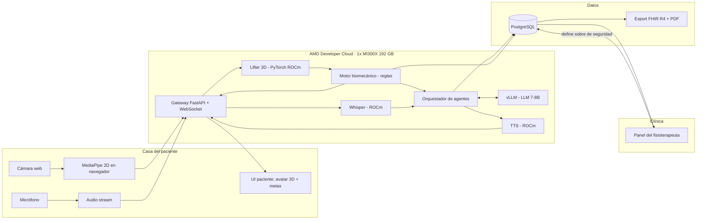
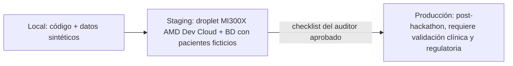

# 02 · Arquitectura

> Proyecto: **AXONFAS** · Entorno actual: **Staging** · Actualizado: 2026-10-06
> Estado de implementación: diseño. En `src/` solo hay el prototipo de validación del navegador y el generador del panel
> de contexto; la arquitectura de abajo todavía no tiene código.

## Tecnologías (explicadas simple)

| Pieza | Tecnología | Para qué sirve |
|---|---|---|
| Captura | MediaPipe Pose en el navegador | Saca 33 puntos del cuerpo en 2D sin enviar el video |
| Transporte | WebSocket (FastAPI) | Envía coordenadas y audio en tiempo real |
| Pose 3D | Modelo "lifter" 2D→3D en PyTorch sobre **ROCm** | Recupera profundidad y rotaciones que el 2D pierde |
| Reglas | Python (NumPy) | Alertas de seguridad deterministas y rápidas |
| Agente clínico | LLM abierto 7–8B servido con **vLLM en ROCm** | Razona, ajusta la sesión, redacta la nota SOAP |
| Voz entrada | Whisper (PyTorch, ROCm) | Voz → texto |
| Voz salida | TTS abierto ligero (PyTorch, ROCm) | Texto → voz natural |
| Datos | PostgreSQL | Pacientes, sesiones, eventos, decisiones |
| Interoperabilidad | FHIR R4 | Que cualquier sistema clínico lea el reporte |
| Cómputo | **AMD Developer Cloud · 1× Instinct MI300X (192 GB HBM3)** | Todos los modelos juntos en una sola GPU |

**ROCm** es el equivalente de AMD a CUDA: permite correr PyTorch y vLLM sobre GPUs AMD sin cambiar el código del modelo.

Por elegir: el modelo lifter y su licencia (TD-05, candidatos abajo). Que el LLM, Whisper y el TTS caben juntos en la GPU se prueba en TD-04.

### Candidatos para el lifter 2D→3D (TD-05, revisado 2026-10-08)

Hay dos licencias distintas que revisar:

- **Código:** MotionBERT y MotionAGFormer son Apache-2.0 y PoseFormerV2 es MIT. Las tres permiten uso comercial.
- **Pesos preentrenados:** ningún repo les declara una licencia propia, y se entrenaron con datasets de uso académico
  (Human3.6M: "academic use only"; MPI-INF-3DHP y AMASS: investigación no comercial). Esas licencias no dicen nada
  explícito sobre modelos entrenados con sus datos, así que es un riesgo legal sin resolver, no una prohibición. Para el
  demo del hackathon basta. Para Producción hace falta revisión legal, licencia comercial del dataset o reentrenar con
  datos propios o con licencia.

**Latencia:** el lifter está dentro del bucle rápido (< 250 ms). Estos modelos procesan ventanas de frames; si se usa la
predicción del centro de la ventana hay que esperar frames futuros (a 30 fps, una ventana de 27 frames centrada espera
≈ 0.45 s). Recomendación: empezar con MotionAGFormer-XS usando la predicción del último frame de la ventana y medir su error
contra la ventana completa. La elección es del equipo.

| Opción | Código | Pesos entrenados con | Ventana | Notas |
|---|---|---|---|---|
| MotionAGFormer-XS | Apache-2.0 | Human3.6M o MPI-INF-3DHP | 27 frames | 2.2 M parámetros, 1.0 GMACs. Primer candidato para el bucle rápido |
| MotionBERT-Lite | Apache-2.0 | Human3.6M, AMASS, PoseTrack, InstaVariety | Hasta 243, variable | 61 MB. Repo activo (último cambio 2026-03) |
| MotionAGFormer-S / B / L | Apache-2.0 | Human3.6M o MPI-INF-3DHP | 81 o 243 frames | Más precisos y más lentos que XS |
| PoseFormerV2 | MIT | Human3.6M | Variable | Último cambio 2025-02 |
| VideoPose3D | CC BY-NC 4.0 | Human3.6M | Variable | Repo archivado. Descartado: el código no permite uso comercial |
| MediaPipe world landmarks (sin lifter) | Apache-2.0 | Modelo propio de Google | 1 frame | 3D en metros con origen en las caderas, en el navegador. Profundidad menos precisa: respaldo, no reemplaza al lifter de ADR-006 |

Los lifters esperan los 17 puntos del formato Human3.6M: hay que mapear los 33 puntos de MediaPipe.

## Por qué AMD es parte del producto y no solo "donde corre"

La tesis es **"toda la clínica en una GPU"** ([ADR-006](04-decisions-adr.md)): los 192 GB de memoria de la MI300X permiten tener cargados al mismo tiempo el LLM, Whisper, el TTS y el modelo de pose, y atender **muchas sesiones de pacientes en paralelo**. Eso define el costo por sesión, que es la métrica de negocio:

```
costo_por_sesión = (precio_GPU_hora × duración_sesión_h) / sesiones_concurrentes
```

Con la MI300X a USD 1.99/h y una sesión de 20 min, el numerador es ≈ USD 0.66. El entregable técnico del hackathon es **medir `sesiones_concurrentes`** manteniendo el bucle rápido < 250 ms (benchmark real, no estimado; TD-08).

El precio de USD 1.99/h lo confirma una medición pública del 2026-09-16 en el tamaño `gpu-mi300x1-192gb-devcloud`, región
`atl1`. La página de precios de DigitalOcean (verificada en junio de 2025) todavía dice USD 2.59/h y está desactualizada.

## Diagrama de componentes



## Agentes (reducidos de 5 a 3 + 1 motor)

La versión anterior tenía 5 agentes LLM. Se reduce porque varios no necesitan un LLM y eso mete latencia y riesgo ([ADR-007](04-decisions-adr.md)):

| Antes | Ahora | Motivo |
|---|---|---|
| Agente de cinemática 3D | **Servicio de pose** (modelo, no agente) | Es inferencia pura, no razona |
| Agente biomecánico | **Motor de reglas** (determinista) | La seguridad no puede depender de un LLM |
| Agente clínico razonador | **Agente clínico** (LLM) | Se mantiene, es el núcleo |
| Agente de voz | **Agente conversacional** (STT + LLM + TTS) | Se mantiene |
| Agente de telemetría | **Agente de reporte** (LLM, al final de la sesión) | Redacta SOAP con datos reales |

## Carpetas del proyecto

Estructura de `_Plantilla Proyecto IA`. Cada componente del diagrama tiene una carpeta asignada; el detalle interno se decide al escribir el código.

| Carpeta | Contenido |
|---|---|
| `.ai-context/` | Estas seis pestañas, `README.md` y `llms.txt` |
| `src/frontend/` | UI del paciente (MediaPipe 2D, micrófono, avatar 3D y metas) y panel del fisioterapeuta |
| `src/frontend/validation-prototype/` | Prototipo de validación (TD-28): página estática con MediaPipe Pose 1.1.0 desde jsDelivr, motor de reglas (`engine.js`), generador de sesiones sintéticas (`synthetic.js`) e interfaz (`app.js`: guía animada del ejercicio, contador y avisos con voz legibles a 2–3 m, pantalla completa). `index.html` usa el design system "HUD Biónico" y toma sus tokens de una sola fuente, `docs/design-system/tokens.css` (enlace relativo `../../../docs/design-system/tokens.css`; `serve.py` sirve esa carpeta en `/docs/design-system/`). En escritorio los tacómetros flotan sobre el video; en tablet y celular pasan a una grilla debajo, la botonera usa botones grandes y el video toma la forma de la cámara. `preview.html` es una copia vieja de `index.html`, pendiente de borrar (TD-37). `serve.py` lo publica en la red local con QR (sección Entornos), y `lanzar-prototipo.cmd` lo arranca con doble clic; también funciona abriendo `index.html` con doble clic, sin QR. Lógica en [01](01-logic.md) |
| `tests/validation-prototype/` | Tests del motor con `node --test` (sin dependencias), sobre sesiones sintéticas |
| `src/frontend/context-panel/` | Generador del panel de contexto: `build_panel.py` (solo biblioteca estándar) convierte estas seis pestañas en una página HTML con `template.html`. La salida va a `dist/` (no se versiona) y se publica como artifact |
| `src/backend/` | Gateway FastAPI + WebSocket, servicio de pose (lifter 3D), motor biomecánico de reglas, servicios STT/TTS, acceso a PostgreSQL y export FHIR R4 + PDF |
| `src/agents/` | Orquestador y prompts de los tres agentes LLM (clínico, conversacional, reporte) y cliente de vLLM |
| `tests/` | Pruebas del motor de reglas y del sobre de seguridad, benchmark de latencia y concurrencia, validación FHIR |
| `config/` | Plantillas de entorno sin valores: `config/.env.staging.example` y `config/.env.prod.example` |
| `data/` | Solo datos sintéticos o del equipo con consentimiento (`raw/`, `processed/`, `vector_store/`). Nunca se versiona |
| `notebooks/` | Experimentos: calibración de umbrales, pruebas del lifter |
| `docs/` | `design-system/` (HUD Biónico: `docs/design-system/tokens.css` y su README, aceptado por el equipo el 2026-10-08) y `meetings/` (privado, fuera del repo) |

Archivos raíz permitidos: `README.md`, `CLAUDE.md`, `.gitignore` y `.gitattributes` (LF en todo el repo, CRLF en
`.cmd`). Repo público: https://github.com/JoseFM2808/AXONFAS, rama `main`.

## Entornos



- **Staging** = todo el hackathon. Solo datos sintéticos o del propio equipo con consentimiento ([ADR-010](04-decisions-adr.md)).
- **Red local (prototipo de validación, TD-33):** `py src/frontend/validation-prototype/serve.py` sirve solo la carpeta del
  prototipo en todas las interfaces. Este equipo usa `http://localhost:8091`; los demás equipos de la misma red usan
  `https://<IP>:8443`, porque los navegadores solo dan la cámara en `localhost` o HTTPS. El certificado es autofirmado
  (30 días, SAN con `localhost` y la IP), lo genera el openssl de Git y vive en `~/.axonfas/certs`, fuera del repo y de
  Drive. `/lan.json` le da a la página la dirección para el QR (`share.js` + qrcode-generator 1.4.4 desde cdnjs). Solo en
  redes de confianza; `--local-only` lo limita a este equipo. Script de lanzamiento: `src/frontend/validation-prototype/lanzar-prototipo.cmd`
  (doble clic; también aparece en el panel de contexto).
- **Producción** = no existe todavía. No se promueve nada sin los puntos bloqueantes de [05-tech-debt.md](05-tech-debt.md) (TD-12 a TD-16).
- **Operación del droplet:** DigitalOcean cobra los GPU Droplets por segundo desde que se crean hasta que se destruyen,
  **aunque estén apagados**. Al terminar cada jornada se toma un snapshot y se destruye el droplet. Los USD 100 de créditos
  del AMD AI Developer Program alcanzan para unas 50 h de MI300X por cuenta (TD-23).
- **CLI de la nube:** AMD Developer Cloud expone la API v2 de DigitalOcean en su propio endpoint
  `https://api.devcloud.amd.com`, así que se maneja con `doctl` pasando `--api-url` (tamaño `gpu-mi300x1-192gb-devcloud`,
  región `atl1`). El token sale del equipo "My AMD Team", lo configura el owner en su propia terminal y nunca entra al
  repo. Que `doctl` funcione con ese endpoint se valida con `doctl account get` en TD-04. Crear un droplet gasta créditos:
  solo con el visto bueno del owner, y todo recurso lleva la etiqueta `axonfas`.
