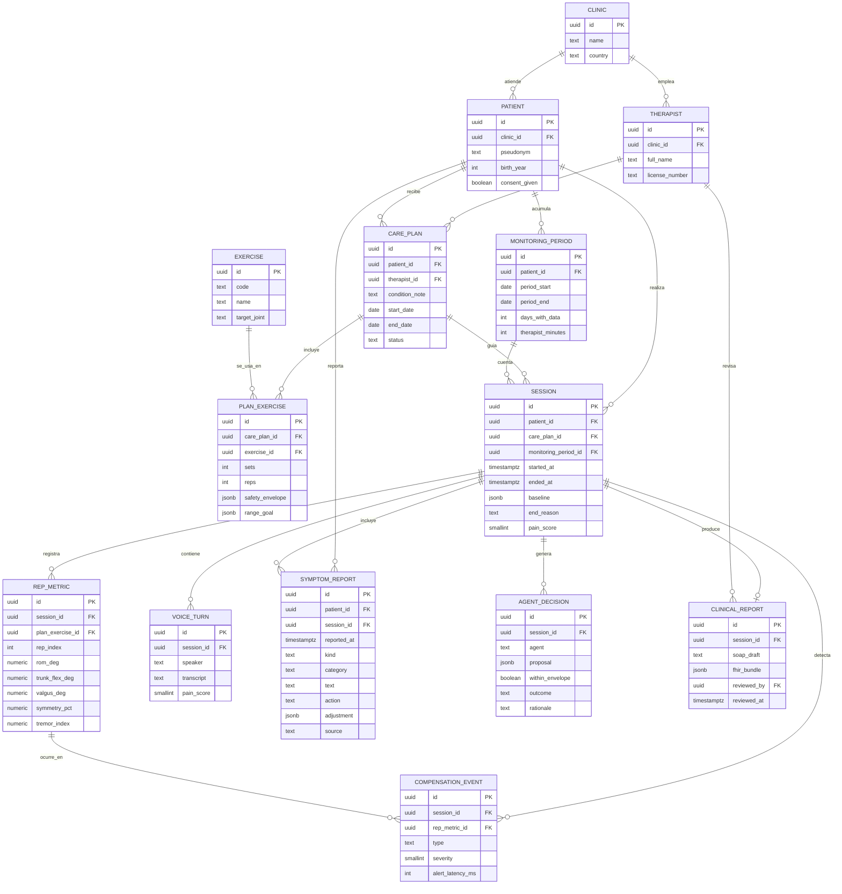

# 03 · Base de datos

> Proyecto: **AXONFAS** · Motor: PostgreSQL · Entorno actual: **Staging** · Actualizado: 2026-10-18
> Estado de implementación: modelo diseñado, sin migraciones todavía. En Staging solo hay pacientes ficticios ([ADR-010](04-decisions-adr.md)).

## Diagrama entidad-relación

## Diccionario de datos (campos clave)

| Tabla | Campo | Tipo | Significado |
|---|---|---|---|
| `patient` | `pseudonym` | text | Alias. En Staging nunca se guarda nombre real |
| `patient` | `consent_given` | boolean | Sin consentimiento no se puede crear `session` |
| `plan_exercise` | `safety_envelope` | jsonb | Límites que fija el terapeuta: `{rom_min, rom_max, max_reps, max_trunk_flex, pain_stop}`. El LLM no puede salir de aquí. En Staging se guarda otra forma (ver "Staging local") y `safety.agent_envelope` la traduce. |
| `session` | `baseline` | jsonb | Valores de las 3 reps de calibración; base para detectar compensación |
| `session` | `end_reason` | text | `completed`, `pain_stop`, `envelope_breach`, `user_quit` |
| `rep_metric` | `rom_deg` | numeric | Rango de movimiento de la articulación objetivo en esa repetición |
| `rep_metric` | `symmetry_pct` | numeric | Diferencia izquierda/derecha en % |
| `rep_metric` | `tremor_index` | numeric | Variación de alta frecuencia de la trayectoria (proxy de fatiga, no diagnóstico) |
| `compensation_event` | `type` | text | `trunk_flexion`, `knee_valgus`, `heel_lift`, `pelvic_rotation`, `asymmetry` |
| `compensation_event` | `alert_latency_ms` | int | Tiempo desde el frame hasta la alerta. Es la métrica del benchmark AMD |
| `voice_turn` | `pain_score` | smallint | 0–10 si el paciente lo menciona; null si no |
| `agent_decision` | `proposal` | jsonb | `{param, old, new, reason}` propuesto por el LLM |
| `agent_decision` | `within_envelope` | boolean | Resultado de validar contra `safety_envelope` |
| `agent_decision` | `outcome` | text | `applied`, `rejected`, `escalated_to_therapist`. Sin propuesta del agente no hay fila; una frase de alarma termina la sesión (`end_reason = 'pain_stop'`) y tampoco es una decisión del agente (ADR-016) |
| `agent_decision` | `agent` | text | Quién propuso. Además de los agentes, `rules` cuando, ante una molestia, la baja la propone el motor de reglas porque el LLM no propuso una válida (ADR-021). En el código de hoy es `source` (`llm` o `rules`) |
| `symptom_report` | `kind` / `action` | text | `kind`: `red_flag` o `discomfort`. `action`: `session_stopped`, `demand_lowered`, `paused` o `logged`. Dato de salud (ADR-021) |
| `plan_exercise` | `rest_min_seconds` / `rest_max_seconds` | int | Descanso entre series recomendado, 10–180 s. Es una recomendación, no forma parte de `safety_envelope` (ADR-022) |
| `clinical_report` | `reviewed_by` | uuid | Terapeuta que aprobó el borrador. Sin revisión, el reporte es borrador |
| `monitoring_period` | `days_with_data` | int | Días con sesión en la ventana de 30 días. Alimenta la facturación RTM |
| `monitoring_period` | `therapist_minutes` | int | Minutos que el terapeuta dedicó a revisar. También cuenta para RTM |

## Reglas de integridad

- `session.monitoring_period_id` debe apuntar a un periodo del mismo `patient_id`.
- `compensation_event.rep_metric_id` debe pertenecer a la misma `session_id`.
- `agent_decision.outcome = 'applied'` solo si `within_envelope = true`.
- `clinical_report.fhir_bundle` solo se exporta fuera de Staging si `reviewed_by` no es null.

## Staging local: SQLite de las cuentas de demostración (ADR-012)

`src/backend/staging_api.py` guarda un subconjunto del modelo anterior en SQLite, en `~/.axonfas/staging.sqlite3`, fuera
del repo y de Drive. Solo datos sintéticos o del equipo con consentimiento (ADR-010).

| Tabla SQLite | Equivale a | Diferencia con el modelo PostgreSQL |
|---|---|---|
| `therapist` | `THERAPIST` | Sin `clinic_id` ni `license_number`: una sola clínica implícita |
| `patient` | `PATIENT` | Agrega `invite_code` (6 caracteres, un solo uso) y `joined_at`; `consent_given` lo marca el propio paciente al afiliarse y vuelve a 0 con un código nuevo (TD-85). `profile` (JSON, ADR-017): `{limitations: [no_floor, no_kneel, no_standing, balance, walking_aid, arm_limited, no_band, low_vision, hearing], pain_areas: [knee, hip, back, neck, shoulder], note (≤ 200), updated_at}`; solo opciones cerradas; dato de salud: Staging, seudónimo y consentimiento. Las bases anteriores ganan la columna al arrancar |
| `token` | — | Tokens bearer (`role` = `therapist`, `patient`, `admin`, `user` para una cuenta de Google que todavía elige rol, `org` para la administración de una organización, con `subject_id` = la organización, y `guest`, el invitado sin registro, con `subject_id` = su fila en `guest`, ADR-028). Las bases anteriores se migran solas al arrancar. No existe en Producción (TD-41). Un código de afiliación nuevo borra los tokens del paciente |
| `app_user` | — | Cuentas de Google (ADR-019): `google_sub` (único), `email`, `name`, `role` (`admin`, `therapist`, `patient`, `pending`), `therapist_id` o `patient_id` vinculados, `disabled`, `created_at`, `last_login_at`. Datos personales de quien entra (equipo y jueces): solo en la base de Staging, fuera del repo; el paciente sigue con seudónimo |
| `plan_exercise` | `CARE_PLAN` + `PLAN_EXERCISE` | El plan se aplana por paciente: `exercise_id` del catálogo, `sets`, `reps`, `hold_seconds`, `per_week`, `safety_envelope` (JSON `{trunk_margin, valgus_margin, max_reps, rom_min?, rom_max?}` solo en monitoreados; `rom_min` y `rom_max` van juntos, entre 10 y 140, con `rom_min < rom_max`. Para el agente, `safety.agent_envelope` copia solo esas claves numéricas y agrega `pain_stop: true`; sin `rom_min`/`rom_max` el agente no puede ajustar el rango. `trunk_margin` es un margen sobre la línea base, no el `max_trunk_flex` absoluto del modelo PostgreSQL), `notes`, `active`, `rest_min_seconds` y `rest_max_seconds` (descanso recomendado, opcionales; si viene uno solo, el otro toma el mismo valor; las bases anteriores ganan las columnas al arrancar, ADR-022) y `range_goal` (JSON `{target, limit, unit}`, opcional, ADR-025: meta de recorrido de un ejercicio de la galería que la cámara mide, en la unidad de su medida en `tracker.js` (°, cm o %); `limit` va más allá de `target` en el sentido del esfuerzo; límites de forma 1–180°, 0,5–50 cm y 1–200 %; nunca en sentarse y pararse ni en los manuales; no es parte del sobre) |
| `session` | `SESSION` + `REP_METRIC` | `mode` (`monitored`/`guided`), `source` (`camera`/`demo`/`guided`), `reps_done`; las métricas por repetición van como JSON en `reps`: en sentarse y pararse monitoreado, `kneeRom`, `peakTrunk`, `peakValgusL/R`, `romReached`, `lowConfidenceRatio` y `calibration`; en el conteo con cámara de la galería (TD-49), `peak` (recorrido máximo desde la posición inicial, en la unidad de la medida), `holdSec`, `holdOk`, `seconds`, `side` (`L`, `R`, `+`, `-`) y `overLimit` (pasó el límite de la meta del plan, ADR-025). Se guardan solo esos campos y con tipos válidos; el resto se descarta. `pain_score` (0–10, CHECK) y `pain_scored_at`: dolor al terminar que marca el paciente (EVA, ADR-025), una vez por sesión; dato de salud: Staging, seudónimo y consentimiento. Las bases anteriores ganan las columnas al arrancar. `no_camera` (0/1) y `no_camera_reason` (`declined`, `denied`, `unavailable` o `guided_view`, ADR-029): los pone el servidor cuando `source = 'guided'`; una sesión sin cámara no admite `peak` ni eventos. Las bases anteriores ganan las columnas y marcan sus sesiones guiadas |
| `compensation_event` | `COMPENSATION_EVENT` | Agrega `side`, `value`, `peak` y `threshold`; `rep` es el índice de la repetición |
| `clinical_report` | `CLINICAL_REPORT` | Una por sesión (`session_id` UNIQUE). `soap_draft` es JSON `{S, O, A, P}`; agrega `facts` (JSON con los datos que la nota puede citar, de `soap.facts`), `source` (`template` o `llm`) y `created_at`. `lang` (`es` o `en`, por defecto `es`) es el idioma en que está escrita la nota e `input` (JSON) la entrada de `soap.facts` al crearla, para redactar un borrador de plantilla sin firmar en el idioma de quien lo abre (ADR-032); al firmar se guarda el texto que se veía y su `lang`. Las bases anteriores ganan las dos columnas al arrancar (`ALTER TABLE`; sus notas quedan en `es` sin `input`). `reviewed_by` y `reviewed_at` van juntos (CHECK): sin ellos es borrador. No guarda `fhir_bundle`: la Observation se genera al pedirla. Las bases anteriores ganan la tabla al arrancar (`CREATE TABLE IF NOT EXISTS`) |
| `symptom_report` | `SYMPTOM_REPORT` (nueva; parte de lo que hoy sería `VOICE_TURN`) | Molestias que avisa el paciente: `patient_id`, `session_id` (se une al guardar la sesión, por id), `exercise_id`, `reported_at`, `kind`, `category` (`red_flag`, `pain`, `cramp`, `fatigue`, `stiffness`, `other`), `text` (≤ 200), `action`, `adjustment` (JSON `{param, old, new}` solo con `demand_lowered`) y `source` (`patient_form` o `voice_turn`). Dato de salud: Staging, seudónimo y consentimiento. Las bases anteriores ganan la tabla al arrancar |
| `guest` | — (nueva) | Invitado sin registro (ADR-028): solo `id` y `created_at`. Ningún dato personal |
| `demo_run` | — (nueva) | Resultado anónimo de la demo pública (ADR-028): `source` (`demo` o `camera`), `exercise_id` (solo `sit-to-stand`), `end_reason`, `reps_done`, `calibration_reps`, `duration_s`, `trunk_events`, `valgus_events`, `low_confidence_reps`, `created_at` y `guest_id` (reservado). No hay columna para puntos, video ni datos personales. Solo la lee el Administrador |
| `app_meta` | — (nueva) | Clave y valor del servidor: hoy `guest_sandbox` = id del fisioterapeuta del consultorio de muestra |
| `organization` | `CLINIC` (Nivel 3) | Organización (ADR-026): `name`, `plan` (`clinic` o `network`), `admin_email` (único: esa cuenta de Google entra como empresa), `ehr_fhir_base_url` (https, sin credenciales) y `ehr_enabled`, `created_at`. Las bases anteriores ganan la tabla al arrancar |
| `org_license` | — (nueva) | Licencia de profesional: `organization_id`, `email` (invitado, en minúsculas), `therapist_id` (se llena al entrar con Google con ese correo y ser fisioterapeuta), `status` (`active` o `revoked`), `created_at`, `revoked_at`. Índice único parcial: un correo, una sola licencia activa |

Reglas que aplica la API:

- Una sesión solo se registra si el paciente dio su consentimiento y el ejercicio está en su plan activo (I-3, I-9).
- `mode = 'monitored'` solo para ejercicios con monitoreo automático en el catálogo.
- Combinaciones que se usan: `monitored` + `camera`/`demo` (sentarse y pararse con alertas), `guided` + `camera`
  (seguimiento con conteo de la galería, ADR-014) y `guided` + `guided` (sin cámara; el paciente marca las series).
- Guardar un plan desactiva el anterior (`active = 0`) en vez de borrarlo, así el historial no pierde referencias.
- Los indicadores (01 · Lógica) se calculan al consultar; no se guardan.
- Los números de cada evento (`value`, `peak`, `threshold`) tienen que ser números finitos o faltar; si no, 400.
  `alertLatencyMs` fuera de 0–60000 se guarda vacío.
- La nota SOAP solo cambia mientras es borrador: firmar guarda A y P (S y O no se editan) y una nota firmada no se
  vuelve a firmar.
- La meta de la nota sale del plan vigente al terminar la sesión; si el reloj del dispositivo quedó antes que el plan,
  se usa el plan más antiguo de ese ejercicio.
- Una molestia solo se registra con consentimiento (403 sin él). Si trae un ejercicio, tiene que estar en el plan
  activo (409). Su decisión es determinista y nunca sale del sobre.
- `symptom_report_ids` de otro paciente o ya unidos a una sesión se ignoran sin error.
- Un código de afiliación nuevo pone `consent_given = 0` (TD-85).
- La EVA de una sesión la marca solo su paciente (404 para otra sesión) y una sola vez (409 la segunda); tiene que ser
  un entero de 0 a 10.
- `GET /api/me` trae por ejercicio del plan `history`: las horas de fin de las sesiones completadas de los últimos 14
  días, para que `care-plan.js` calcule el día en la hora local.

## Almacenamiento en el navegador

No es una base de datos: son claves de `localStorage` del navegador de quien usa la web. No viajan al servidor.

| Clave | Contenido | Origen |
|---|---|---|
| `axonfas.therapist`, `axonfas.patient`, `axonfas.admin`, `axonfas.user` | Token de cada rol (`api-client.js`) | ADR-012, ADR-019, TD-41 |
| `axonfas.org` | Token de la administración de una organización (`empresa.html`, Nivel 3) | ADR-026 |
| `axonfas.guest` | Token del invitado; se borra al entrar con una cuenta de verdad | ADR-028 |
| `axonfas.lang` | Idioma elegido a mano con el selector de la cabecera (`es` o `en`). Gana a la detección por el navegador; si no está, el idioma se decide en cada visita sin guardar nada | ADR-030 |
| `axonfas.tutorial` | Ejercicios cuyo tutorial "Mira y sigue" ya se vio en este equipo (hasta 50 ids) | ADR-029 |
| `axonfas.demoShare` | `off` si la persona desmarcó "Compartir resultados anónimos de la demo" | ADR-028 |
| `axonfas.triage` | Resultado del triaje del Nivel 1: `{v, status: 'clear' \| 'blocked', until, tone: 'standard' \| 'gentle'}`. Nunca las respuestas: ni qué bandera se marcó ni las amarillas. Vence a los 7 días (`clear`) o a las 24 h (`blocked`); con otra `v` se vuelve a preguntar | ADR-023 |
