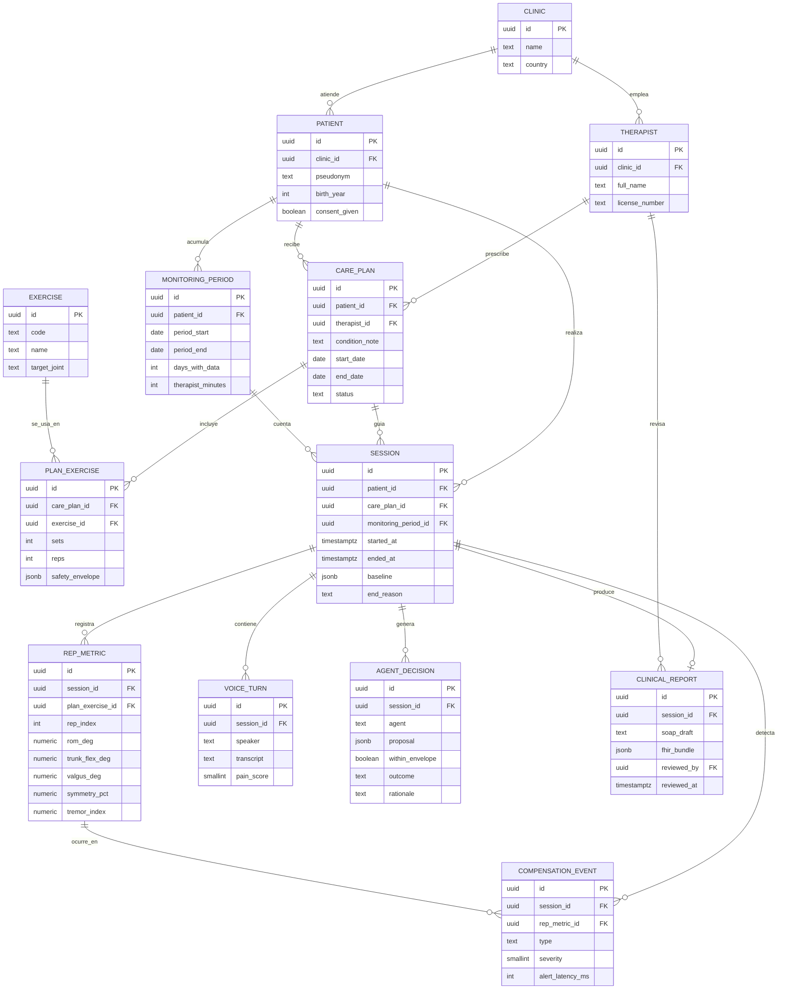

# 03 · Base de datos

> Proyecto: **AXONFAS** · Motor: PostgreSQL · Entorno actual: **Staging** · Actualizado: 2026-10-11
> Estado de implementación: modelo diseñado, sin migraciones todavía. En Staging solo hay pacientes ficticios ([ADR-010](04-decisions-adr.md)).

## Diagrama entidad-relación

## Diccionario de datos (campos clave)

| Tabla | Campo | Tipo | Significado |
|---|---|---|---|
| `patient` | `pseudonym` | text | Alias. En Staging nunca se guarda nombre real |
| `patient` | `consent_given` | boolean | Sin consentimiento no se puede crear `session` |
| `plan_exercise` | `safety_envelope` | jsonb | Límites que fija el terapeuta: `{rom_min, rom_max, max_reps, max_trunk_flex, pain_stop}`. El LLM no puede salir de aquí |
| `session` | `baseline` | jsonb | Valores de las 3 reps de calibración; base para detectar compensación |
| `session` | `end_reason` | text | `completed`, `pain_stop`, `envelope_breach`, `user_quit` |
| `rep_metric` | `rom_deg` | numeric | Rango de movimiento de la articulación objetivo en esa repetición |
| `rep_metric` | `symmetry_pct` | numeric | Diferencia izquierda/derecha en % |
| `rep_metric` | `tremor_index` | numeric | Variación de alta frecuencia de la trayectoria (proxy de fatiga, no diagnóstico) |
| `compensation_event` | `type` | text | `trunk_flexion`, `knee_valgus`, `heel_lift`, `pelvic_rotation`, `asymmetry` |
| `compensation_event` | `alert_latency_ms` | int | Tiempo desde el frame hasta la alerta. Es la métrica del benchmark AMD |
| `voice_turn` | `pain_score` | smallint | 0–10 si el paciente lo menciona; null si no |
| `agent_decision` | `proposal` | jsonb | `{param, old, new, reason}` propuesto por el LLM |
| `agent_decision` | `within_envelope` | boolean | Resultado de validar contra `safety_envelope` |
| `agent_decision` | `outcome` | text | `applied`, `rejected`, `escalated_to_therapist` |
| `clinical_report` | `reviewed_by` | uuid | Terapeuta que aprobó el borrador. Sin revisión, el reporte es borrador |
| `monitoring_period` | `days_with_data` | int | Días con sesión en la ventana de 30 días. Alimenta la facturación RTM |
| `monitoring_period` | `therapist_minutes` | int | Minutos que el terapeuta dedicó a revisar. También cuenta para RTM |

## Reglas de integridad

- `session.monitoring_period_id` debe apuntar a un periodo del mismo `patient_id`.
- `compensation_event.rep_metric_id` debe pertenecer a la misma `session_id`.
- `agent_decision.outcome = 'applied'` solo si `within_envelope = true`.
- `clinical_report.fhir_bundle` solo se exporta fuera de Staging si `reviewed_by` no es null.

## Staging local: SQLite de las cuentas de demostración (ADR-012)

`src/backend/staging_api.py` guarda un subconjunto del modelo anterior en SQLite, en `~/.axonfas/staging.sqlite3`, fuera
del repo y de Drive. Solo datos sintéticos o del equipo con consentimiento (ADR-010).

| Tabla SQLite | Equivale a | Diferencia con el modelo PostgreSQL |
|---|---|---|
| `therapist` | `THERAPIST` | Sin `clinic_id` ni `license_number`: una sola clínica implícita |
| `patient` | `PATIENT` | Agrega `invite_code` (6 caracteres, un solo uso) y `joined_at`; `consent_given` lo marca el propio paciente al afiliarse |
| `token` | — | Tokens bearer de las cuentas de demostración (`role` = `therapist` o `patient`). No existe en Producción (TD-41) |
| `plan_exercise` | `CARE_PLAN` + `PLAN_EXERCISE` | El plan se aplana por paciente: `exercise_id` del catálogo, `sets`, `reps`, `hold_seconds`, `per_week`, `safety_envelope` (JSON `{trunk_margin, valgus_margin, max_reps}` solo en monitoreados), `notes`, `active` |
| `session` | `SESSION` + `REP_METRIC` | `mode` (`monitored`/`guided`), `source` (`camera`/`demo`/`guided`), `reps_done`; las métricas por repetición van como JSON en `reps`: en sentarse y pararse monitoreado, `kneeRom`, `peakTrunk`, `peakValgusL/R`, `romReached`, `lowConfidenceRatio` y `calibration`; en el conteo con cámara de la galería (TD-49), `peak` (recorrido máximo desde la posición inicial, en la unidad de la medida), `holdSec`, `holdOk`, `seconds` y `side` (`L`, `R`, `+`, `-`). Se guardan solo esos campos y con tipos válidos; el resto se descarta |
| `compensation_event` | `COMPENSATION_EVENT` | Agrega `side`, `value`, `peak` y `threshold`; `rep` es el índice de la repetición |

Reglas que aplica la API:

- Una sesión solo se registra si el paciente dio su consentimiento y el ejercicio está en su plan activo (I-3, I-9).
- `mode = 'monitored'` solo para ejercicios con monitoreo automático en el catálogo.
- Combinaciones que se usan: `monitored` + `camera`/`demo` (sentarse y pararse con alertas), `guided` + `camera`
  (seguimiento con conteo de la galería, ADR-014) y `guided` + `guided` (sin cámara; el paciente marca las series).
- Guardar un plan desactiva el anterior (`active = 0`) en vez de borrarlo, así el historial no pierde referencias.
- Los indicadores (01 · Lógica) se calculan al consultar; no se guardan.
